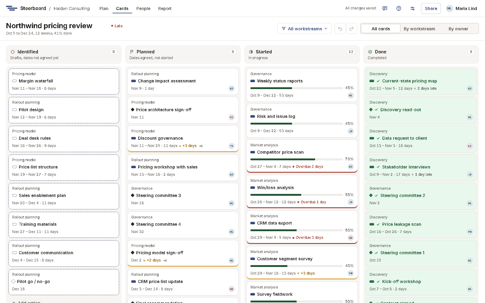

# Cards

**Cards** shows the plan's work as cards in four columns, for running the
week. It's the same plan: a card's column comes from what the plan already
says, so the plan and the cards never disagree.

| Column | What's in it |
|---|---|
| **Identified** | Drafts: pencilled in, dates not agreed yet. |
| **Planned** | Dates agreed, not started. Delays are measured against them. |
| **Started** | In progress, with how far along it is. |
| **Done** | Completed, most recently finished first. |

Each card shows its workstream, dates and length, progress, any delay
("+3 days", "Overdue 2 days"), whether it waits for something unfinished, and
its owner. Cards are in date order within a column, so the board reads like
the plan; to change the order, change the dates.

## Move a card

Drag it to another column, and it makes the same change the plan would:

- **Planned** agrees a draft's dates.
- **Started** starts the work today, and puts it at the top of the column.
- **Done** marks it completed.
- **Identified** puts unstarted work back to a draft.

Work with agreed dates can't go back to **Identified** (change its agreed
dates instead), and milestones skip **Started**, since they're done or not. While you drag, a
column a card can't go to is hatched, and says why.

## Progress on a card

Slide the progress bar on a started card to set how far along it is. The card
stays where it is. Sliding it to 0% or 100% asks whether to move the card back
to **Planned** (or **Identified**) or on to **Done**.

## Lanes

Choose **All cards**, **By workstream** or **By owner** in the toolbar.

- Drag a card to another workstream's lane to move it into that workstream.
  Its dates stay.
- Drag a card to another person's lane to hand it over.
- Dropping in another column and lane does both in one step.

## Add, open and delete

- Add a card at the foot of any column (and lane): type what needs doing and
  press <kbd>Enter</kbd>, or choose the diamond for a milestone. It starts in
  that column, workstream or owner.
- Click a card for the same [details panel](plan/details.md) as on the plan.
- Right-click a card for the stages, **Change agreed dates…** and delete.
- <kbd>Ctrl</kbd>-click or <kbd>Shift</kbd>-click several cards to move them
  together.
