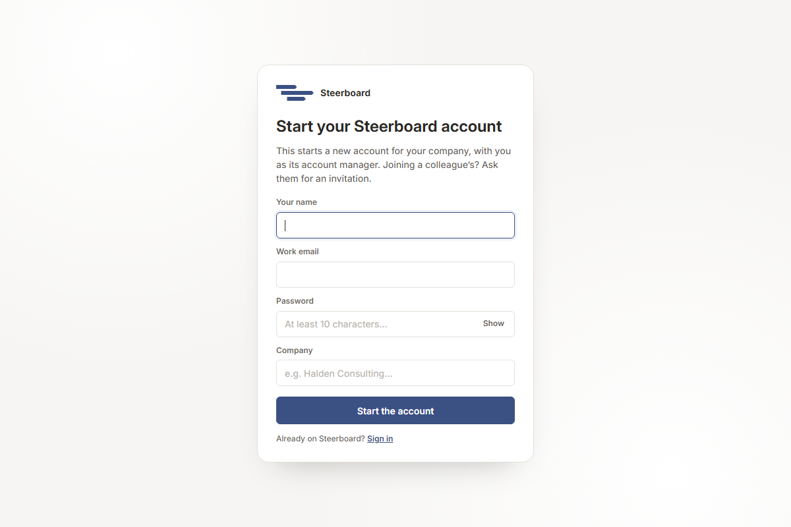

# Create an account

Go to [steer-board.com](https://steer-board.com) and choose **Sign up**.

Fill in:

| Field | What to enter |
|---|---|
| **Your name** | How your name appears on plans and to your team. |
| **Work email** | You sign in with it. Invitations and password resets go to it. |
| **Password** | At least 10 characters. |
| **Company** | Your firm's name. It becomes the name of your account and of your first group. You can rename both later. |

Then choose **Start the account**. You're signed in straight away, and you're
the account's *account manager*: you can invite people, make groups and
change the account's settings. The account starts with a demo project to look
around in (see [Your first project](first-project.md)).

## Joining a colleague's account

Don't sign up on your own if your firm already uses Steerboard: you'd start a
second, separate account. Ask an account manager to invite you instead. The
invitation is a link; open it, choose a password, and you're in their
account, with the projects they've shared with you.

## Signing in

Choose **Log in** at the top right of [steer-board.com](https://steer-board.com),
or go straight to [steer-board.com/login](https://steer-board.com/login). Enter
your email and password and choose **Sign in**.

If your company has set up single sign-on, entering your email sends you to
your company's sign-in page instead.

## Forgotten your password

On the sign-in page, choose **Forgotten your password?** and enter your email.
You'll get a link to choose a new password. It works once, for an hour, and
signs you out everywhere else.

## Next

[Your first project](first-project.md)
