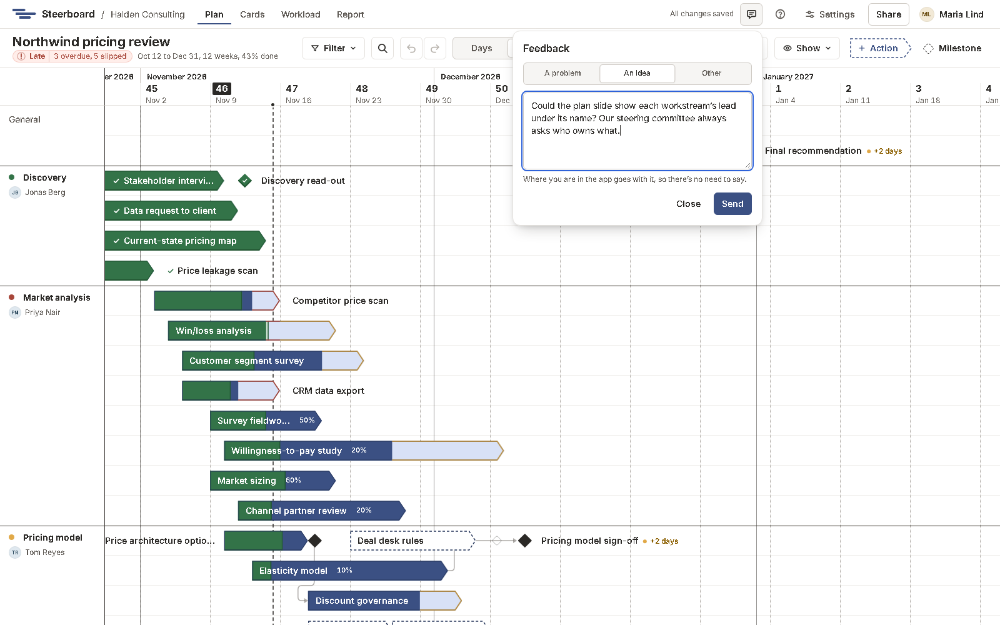

# Feedback

Something doesn't work, or you wish Steerboard did something it doesn't? Tell
us from where you are, without leaving your work.

1. Choose **Feedback** (the speech bubble) in the bar at the top. It's there on
   every page, and in every project. **Send feedback** under the question mark
   opens the same panel.
2. Pick what it's about: **A problem**, **An idea** or **Other**.
3. Write it down and choose **Send**, or press <kbd>Ctrl</kbd>+<kbd>Enter</kbd>.

Where you are in the app goes with it: the page, the screen, the project and
your browser. You don't need to explain where you were, only what happened or
what you'd like.

If you close the panel before sending, what you wrote stays there until you
send it or leave the app.

## What happens next

We read everything that's sent, every week, and decide what to do with each:
build it, answer it (when it already works, or there's a way to do it), or not
now. Ideas that many people send move up.

For something urgent, such as not being able to sign in, tell your account
manager as well.
