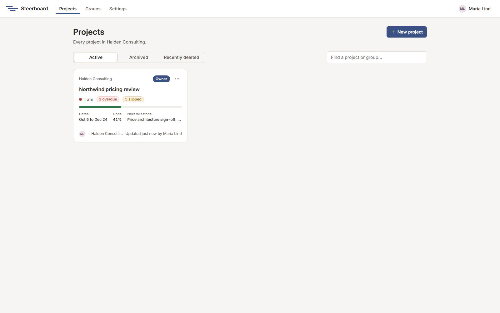
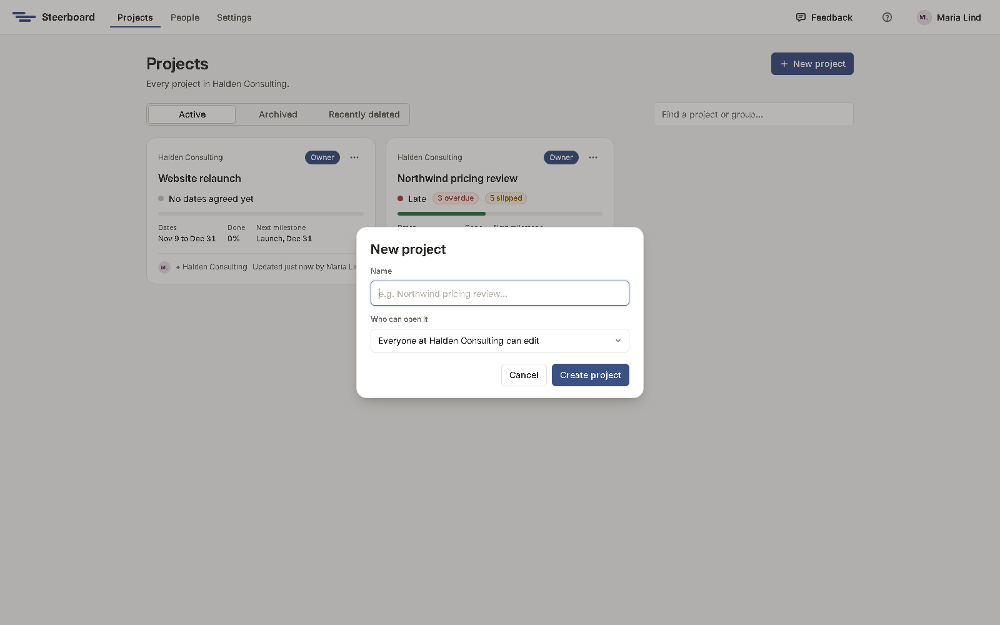

# Your first project

After you sign in you land on **Projects**: every project you own, edit or
view. Each card shows the project's status in a few words, how much is done,
its dates and its next milestone.

A new account starts with two projects already there:

- **Northwind pricing review**, a demo engagement with a bit of everything:
  finished work, work in progress, work that's late, drafts, a team in three
  groups and a status report. Its team is in your [Groups](../sharing/groups.md)
  too.
- **Website relaunch**, a small sample plan with phases, links and a launch.

They're the quickest way to see what each screen does before you build your
own plan. They're yours to change, and to delete when you're done with them.

## Start a project

Choose **New project** and give it a name.

Under **Who can open it**, choose whether everyone in your group can edit it,
only view it, or not see it until you share it. You can change this later from
**Share**.

Choose **Create project** and the plan opens.

## Find, archive and delete projects

The tabs above the cards are **Active**, **Archived** and **Recently deleted**.
Use the search box to find a project or a group.

Each card's menu (the three dots) holds the rest: make a copy, download the
project as a file, archive it when the work is over, or delete it. A deleted
project can be restored from **Recently deleted** for 30 days.

An account keeps up to 20 projects on the Standard plan, archived ones
included; deleting one you no longer need makes room. See
[What a plan allows](../sharing/settings.md#what-a-plan-allows).

## Next

[A tour of the screens](tour.md)
