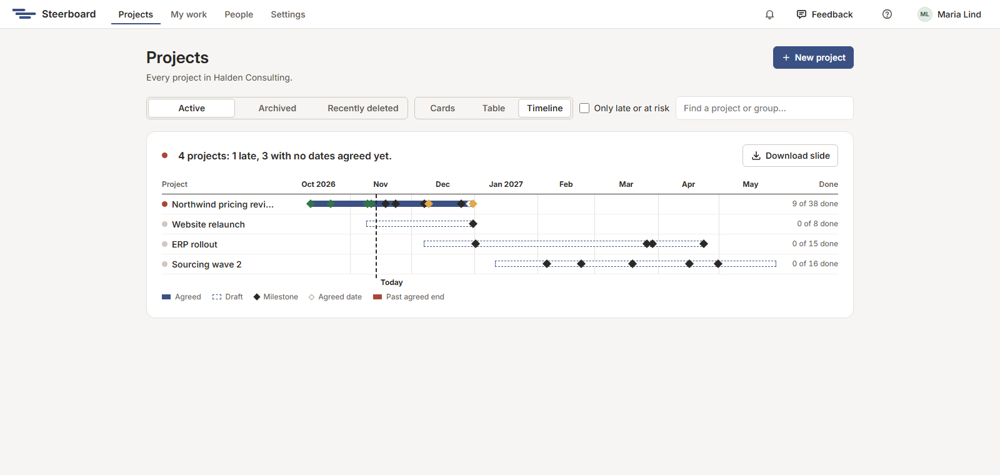

# Your first project

After you sign in you land on **Projects**: every project you own, edit or
view. Each card shows the project's status in a few words, how much is done,
its dates and its next milestone.

A new account starts with two projects already there:

- **Northwind pricing review**, a demo engagement with a bit of everything:
  finished work, work in progress, work that's late, drafts, a team in three
  groups and a status report. Its team is in your [People](../sharing/people.md)
  too.
- **Website relaunch**, a small sample plan with workstreams, links and a launch.

Use them to see what each screen does before you build your
own plan. They're yours to change, and to delete when you're done with them.

## Start a project

Choose **New project** and give it a name. (Starting a project is for
planners and account managers; viewers and contributors see the projects
shared with them. See [People and groups](../sharing/people.md#access).)

Under **Start from**, choose what the plan begins with:

- **Blank**: an empty plan.
- **Template**: one of four plans to reshape. A consulting engagement, a system
  roll-out, a sourcing project (a tender), or a programme with steering
  committees. Each says what it's for, how much is in it and how many weeks it
  runs.
- **A copy**: one of your own projects. With **Start it afresh** ticked, the
  new project has that plan's workstreams, work, people and links, and
  nothing of what happened: everything is a draft again, with no progress,
  agreed dates or history. Unticked, it's a copy as it stands.

A template and a fresh copy need a start date. Pick any day under **Starts in the week
of**: the plan starts on that week's Monday, and everything arrives as a
draft.

Under **Who can open it**, choose whether everyone in your group can edit it,
only view it, or not see it until you share it. You can change this later from
**Share**. (A copy goes where **Make a copy** puts one: in the same group, for
everyone in it to edit.)

Choose **Create project** and the plan opens.

The first time you open an empty plan, a small card at the bottom left of the
board lists three first steps: add an activity, draw one to size, and find the
rest with a right-click. Each is ticked once you've done it. When all three
are, the card goes; its × puts it away sooner.

## Find, archive and delete projects

The tabs above the cards are **Active**, **Archived** and **Recently deleted**.
Use the search box to find a project or a group.

With more than a handful of projects, choose **Table** beside those tabs. Each
project is then a line: its status, how much is done, its next milestone, its
finish against what was agreed, when its last report was issued, and its
owner. Choose a heading to sort by it; by **Status**, the late ones come
first. **Only late or at risk** leaves only the projects that need a look,
as cards or as a table. **Cards** brings the cards back.

**Timeline** draws your projects on one time scale, a line each: its bar, its
milestones, how it stands and how much is done, with today marked. It's the
status report's workstream timeline, one level up. Choose a project's name or
a milestone to open it. **Download slide** saves the timeline as a PowerPoint
slide, for a programme or portfolio meeting. The search and
**Only late or at risk** choose which projects are on it.

Each card's menu (the three dots) holds the rest: make a copy, download the
project as a file, archive it when the work is over, or delete it. A deleted
project can be restored from **Recently deleted** for 30 days.

An account keeps as many projects as its tier has room for, archived ones
included: 20 while Steerboard is in early access. Deleting one you no longer
need makes room. See [The subscription](../sharing/settings.md#the-subscription).

## Next

[A tour of the screens](tour.md)
