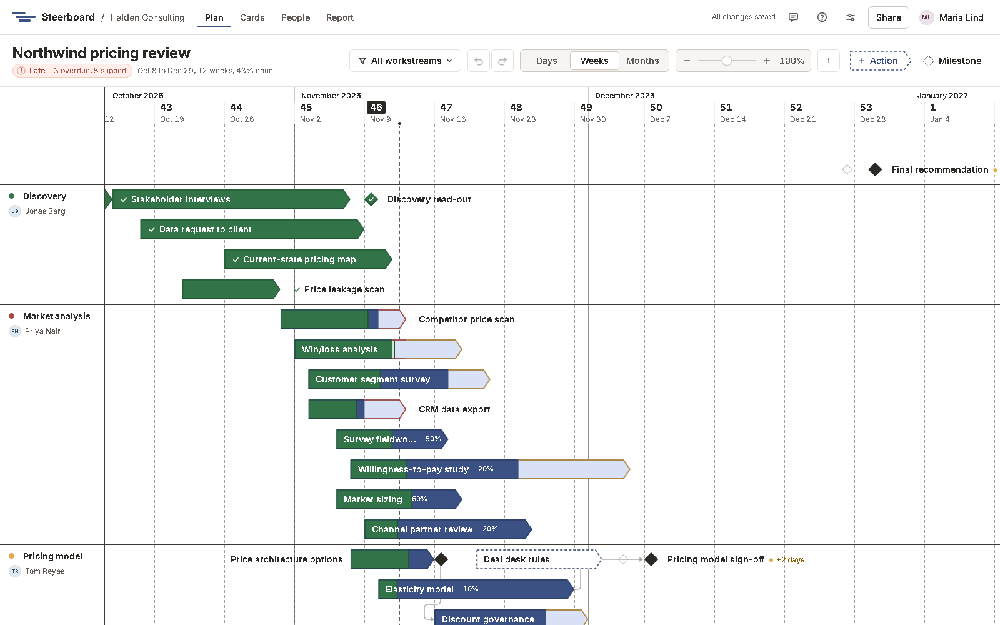
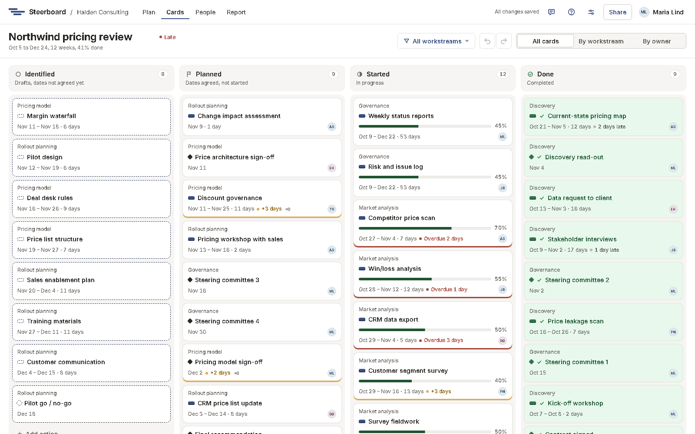
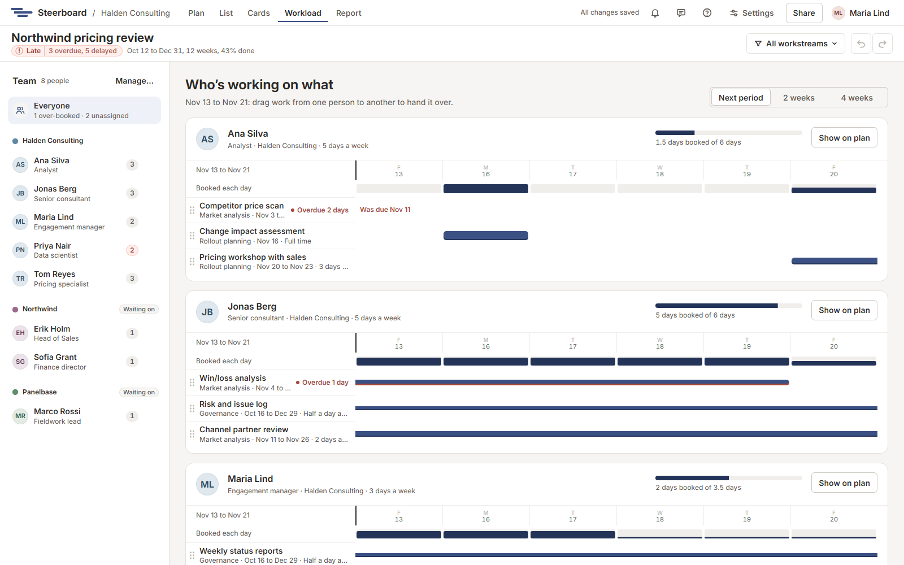
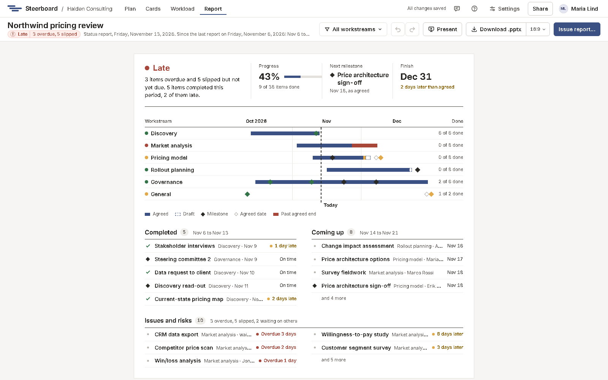

# A tour of the screens

A project has five screens, in the bar at the top: **Plan**, **List**,
**Cards**, **Workload** and **Report**. They're five views of one plan. Change something in
one and it has changed in all of them, for everyone with the project open.

Switch between them with the tabs, or with <kbd>Alt</kbd>+<kbd>1</kbd> to
<kbd>Alt</kbd>+<kbd>5</kbd>.

## The bar at the top

From left to right:

- **Steerboard** and the group that owns the project. The logo takes you back
  to your projects.
- The five screens.
- The save state. Changes save as you make them, so it normally says
  **All changes saved**.
- The avatars of anyone else who has the project open right now.
- The bell, **For you**: work given to you, updates that name you, your work
  that's overdue, and status reports that are due on projects you own. A number
  on it says how many are new since you last looked. Choose one to go to it.
- **Feedback** (the speech bubble), to tell us what doesn't work or what you'd
  like, without leaving your work. See [Feedback](feedback.md).
- Help (the question mark), a menu: **Docs for this page** opens these docs in
  a new window at the page for the screen you're on, **Keyboard shortcuts**
  lists them (so does pressing <kbd>?</kbd>), **What’s new** opens
  [what has changed](../whats-new.md), and **Send feedback** opens the
  feedback box.
- [Project settings](../project-settings.md) (**Settings**): the project's
  name, reporting, holidays and people. Then **Share**, which opens the
  project's people, and your account menu. The
  account menu has **Docs** too.

Under it, the toolbar holds the plan's name, its status in a few words, and
the tools for the screen you're on.

On a phone held upright the bar keeps the logo, **Feedback** and your account
menu, which has **Projects**, **People** (for planners and account managers),
**Settings** and **Docs**; the toolbar's tools are one row you can swipe
sideways.

## Plan

The board: the plan drawn the way the plan slide draws it. Workstreams are
lined off down the left with their leads; activities are boats along the
rows; milestones are diamonds. You add, move and stretch everything
directly, and pull a box across free space to select several at once. See [The board](../plan/board.md).

## Cards

The same work as cards in four columns: **Draft**, **Planned**,
**In progress** and **Done**. Good for running the week's work. See
[Cards](../cards.md).

## Workload

The team, in their groups, and what each person is working on over the next
period: how many days they're booked, day by day, and each piece of work. See
[Workload](../workload.md).

## Report

The status report, written from the plan: the status on one page, then the
detail. Present it full screen or download it as PowerPoint slides. See
[The report](../report/index.md).

## Links keep what's on screen

A project's address says which screen, lanes and item are showing, so a link
you send or a page you reload opens the same view.
