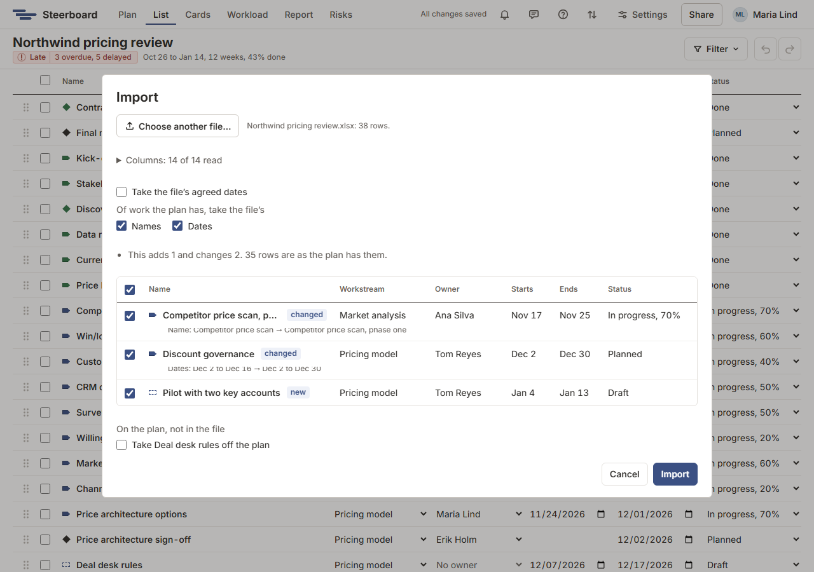

# Import and export

A plan made in Steerboard can go out to Excel, be changed there and come back:
each row updates the work it came from. A plan can also go out as a CSV file or
a Microsoft Project file, and come in from those or from Jira.
**Import and export** is the two arrows in the bar at the top of a project, on
every view.

## Work on the plan in Excel

1. Choose **Import and export**, then **Export…**. Pick **Excel workbook** and
   choose **Download**.
2. Change the workbook in Excel, or send it round for others to fill in. Move
   dates, rename work, change owners, notes and progress, and set the status
   to In progress or Done. Status, type, owner and workstream have drop-down
   lists; a new owner or workstream can still be typed. Add new work as a row
   with the first column empty. Delete the row of work that's no longer part
   of the plan.
3. Choose **Import and export**, then **Import…**, and choose the workbook.
   You see each change, from what to what, and the new rows. Rows you deleted
   are under **On the plan, not in the file**: tick them to take that work
   off the plan.
4. Untick what you don't want and choose **Import**. One undo takes it all
   back.

The first column, shaded grey, is the Steerboard ID. Leave it as it is: it's
how each row is known again.

The workbook remembers the plan as it was when you exported it. If people
change the plan in Steerboard while the workbook is out, their changes stay:
only what was changed in the workbook is offered. Something changed in both
places is offered with a note and starts unticked. Work added in Steerboard
in the meantime stays too.

A CSV file works the same way, except that it can't remember the plan. Values
changed in Steerboard since you exported it show as changes, so export a new
file before you start.

## Export

Choose **Import and export**, then **Export…**. Pick the kind of file and
choose **Download**.

- **Excel workbook**: a line for each activity and milestone, in the plan's
  order, with its workstream, the work packages it's in, its owner, dates,
  status, progress, agreed dates, what it starts after and its notes. Dates
  are dates and progress is a percentage, so Excel sorts and filters them.
- **CSV file**: the same lines as plain text, for any spreadsheet.
- **Microsoft Project**: an XML file. In Project, open it with File, Open and
  the file type XML Format. Each workstream is a summary task, a work package
  is a summary task under it, and the agreed dates are the baseline.
- **Steerboard file**: the whole project with its history, to keep, or to
  start a project from.

Anyone who can open the project can export it. The first three are part of
some tiers; the Steerboard file is on every tier.

## Import

Importing is for people who can change the plan. Choose **Import and export**,
then **Import…**, then **Choose a file…**. You can also drop a file on the
dialog, or paste rows copied from a table into the box. In the List view, rows
pasted onto the list open the same dialog with the rows in it.

Nothing changes yet. The dialog shows what the file would do:

- New rows, as the lines they would become.
- Rows that change work the plan has, with what changes, from what to what.
- How many rows are as the plan already has them.
- **On the plan, not in the file**: work the file no longer holds. It stays on
  the plan unless you tick it.

Untick a row to leave it out. **Import** does what's ticked as one step, and
one undo takes all of it back. Up to 1,000 rows are read at once.

### How a row is known again

By its ID. A file Steerboard exported has the Steerboard ID of every line. A
Microsoft Project file has each task's unique ID, and a Jira export each
issue's key; Steerboard keeps that ID with the work when it first comes in. So
a file that is exported, changed and imported again updates the work it came
from, and a Project or Jira file imported a second time updates what the first
import made.

A file without IDs adds every row as new work. To go by names instead, tick
**A row with the name of work on the plan is that work**. A name is only gone
by when one piece of work on the plan has it.

### What a file changes

- Only columns the file has are compared, and an empty cell changes nothing.
- Dates from a file are planned dates. If they move work whose dates are
  agreed, the work shows as delayed and its agreed dates stay. To take the
  file's agreed dates (a baseline, in Microsoft Project) as well, tick
  **Take the file’s agreed dates**. That change is kept in the work's history.
- Under **Of work the plan has, take the file’s**, untick what the plan should
  keep: its names, dates, owners and so on.
- An owner is matched by name to the plan's team. Someone who isn't on the
  team is named in the dialog, with a box to add them. Left unticked, their
  rows come in with no owner.
- A workstream the plan doesn't have is added. A work package the file names
  is the plan's of that name, or a new one.
- New work comes in as a draft. Rows that say they're in progress or done
  come in so, with their dates agreed.

### Columns

**Columns** lists each column of the file with what's in it and what
Steerboard takes it for. Change any of them, or choose **Left out**. The
headings Steerboard, Microsoft Project and Jira write are read as they are.
Without a row of headings, the columns are told from what's in them.

Dates can be written the usual ways: 2026-11-30, 30/11/2026, 30.11.26,
30 Nov 2026, Nov 30. With numbers only, the day comes first unless a date in
the file can only be read the other way. A row with both dates is an activity.
A row with only the date it's due is a milestone, unless the file says what
kind of thing each row is.

### What each kind of file brings

- **Excel** (.xlsx): the sheet with the most in it. An older .xls file needs
  saving as .xlsx first.
- **CSV**: values separated by commas, semicolons or tabs.
- **Microsoft Project**: the .mpp file itself, or the plan saved from Project
  as XML (File, Save As, XML Format (*.xml)). An .mpp file is read on
  Steerboard's server; one with a password can't be, so save that one as XML.
  The top of the outline becomes workstreams and the summary tasks under it
  work packages. A
  single summary task with everything under it is taken for the project
  itself. A baseline becomes the agreed dates, percent complete the progress,
  and the first person on a task its owner. Finish-to-start links become
  "starts after"; other links and waits on links are left out, and the dialog
  says how many.
- **Jira**: export the issues as CSV. An epic becomes a workstream, an issue
  with sub-tasks a work package, and "is blocked by" becomes "starts after".
  An issue with only a due date is an activity ending that day. The
  description is left out unless you choose it as the notes under **Columns**.

## Start a project from a file

**New project** on the Projects page has **A file** under **Start from**. It
reads the same kinds of file, and a Steerboard file too. See
[Your first project](getting-started/first-project.md).
