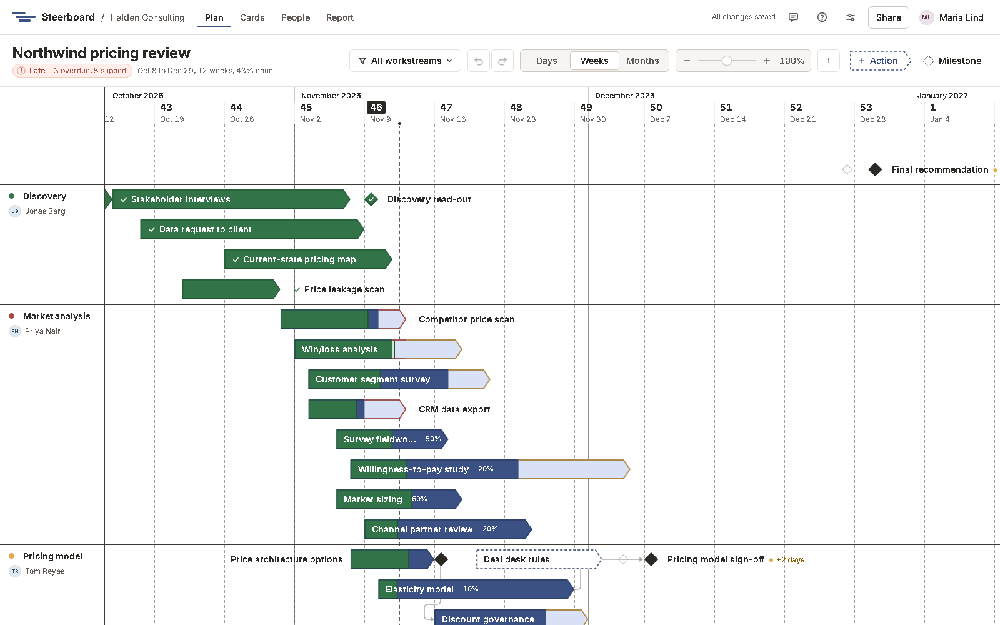

# Steerboard docs

Steerboard is a planning tool for projects that report to a client or a
steering committee, from consulting engagements to internal programmes. It
draws the plan the way the plan slide does: activities as boats along rows,
milestones as diamonds, workstreams lined off down the left. Then it follows
the project as it unfolds. The team works on the plan together, dates are
agreed with your client, a delay shows by itself against what was agreed, and
the status report is written from the plan.

These pages explain how to use it. If you're new, start with
[Create an account](getting-started/account.md) and
[Your first project](getting-started/first-project.md), then take
[a tour of the screens](getting-started/tour.md).

## Where to start

| If you want to | Go to |
|---|---|
| Start using Steerboard | [Create an account](getting-started/account.md) |
| Make a project, blank or from the demo | [Your first project](getting-started/first-project.md) |
| Find your way around a project | [A tour of the screens](getting-started/tour.md) |
| Draw and change the plan | [The board](plan/board.md) and [Activities and milestones](plan/items.md) |
| Line the plan off into workstreams | [Workstreams and groups](plan/workstreams.md) |
| Make one piece of work wait for another | [Links between work](plan/links.md) |
| Agree dates with the client and track delays | [Agreed dates and delays](plan/agreed-dates.md) |
| Run the week's work as cards | [Cards](cards.md) |
| See who's working on what | [Workload](workload.md) |
| Write and send the status report | [The report](report/index.md) and [Present and download](report/present.md) |
| Bring in your team and your client | [Sharing a project](sharing/sharing.md) and [People and groups](sharing/people.md) |
| Read the plan's marks | [The marks](reference/marks.md) |

## How these pages are written

Words in **bold** are what you see on screen: a button, a menu item, a field or
a tab, written exactly as the app writes it.

"The plan" means one project's plan. An *activity* is
work that takes time; a *milestone* is a moment, such as a sign-off.

Keys are shown like <kbd>Ctrl</kbd>+<kbd>Z</kbd>. On a Mac, use
<kbd>Cmd</kbd> where these pages say <kbd>Ctrl</kbd>.
