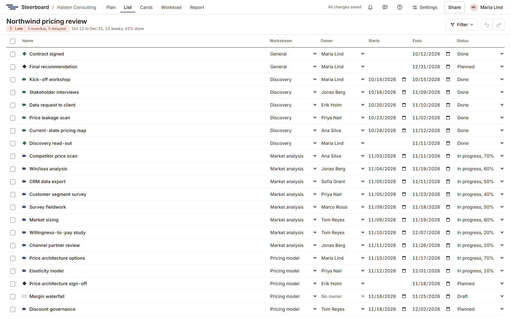

# List

**List** shows the plan as a list: a line for each activity and milestone, to
read down, sort, type into and paste into. It's the same plan as the board's,
so what you change here has changed there.

Each line has the item's **Name**, **Workstream**, **Owner**, when it **Starts**
and **Ends**, and its **Status**. The mark before the name is the one the plan
draws: a boat for an activity, a diamond for a milestone, dashed while it's a
draft and green when it's done. A milestone has one date, under **Ends**. A
work package isn't a line of its own; the name of the package an item is in
follows the item's name.

The lines come in the plan's order, as the plan reads from the top: workstream
by workstream, row by row, and each row from left to right. Choose a column's
heading to sort by it, again for the other way round, and a third time for the
plan's order. **Filter** works as on the plan.

## Move a line

If you can change the plan, drag a line up or down by the handle before its
box. A mark shows where it will go. Let go, and the item is there in the list
and on the plan too, on a row of its own, with its dates as they were. Press
<kbd>Escape</kbd> to let go without moving it.

- Put by a line of another workstream, it's in that workstream.
- Put among the lines of a work package, it's in that package, as when you
  drag it there on the plan. See [Work packages](plan/workstreams.md#work-packages).
- Items that share a row on the plan follow each other in the list and keep
  together: an item is put above or below all of them.

With the keyboard, go to the handle and press <kbd>↑</kbd> or <kbd>↓</kbd>.

Lines move in the plan's order. While the list is sorted by a column the
handles are faint: choose the heading until the sorting is off.

## Type in a line

If you can change the plan, every line is a row of boxes:

- Type a new name and press <kbd>Enter</kbd>, which also takes you to the line
  below.
- Choose another workstream or owner.
- Change a date. Dates follow the plan's working days, as in the
  [details panel](plan/details.md): a start or an end on a day off moves to a
  working day.
- Choose a status. A draft's only choice is **Planned (agree its dates)**:
  dates are agreed before work starts. See
  [Agreed dates and delays](plan/agreed-dates.md).

Each change is one step for undo.

## Add a line

The last line is for the next item. Choose **Activity** or **Milestone**, type
its name and press <kbd>Enter</kbd>. The cursor stays there, so you can type
one after the other.

A new line is a draft. An activity is five working days long, starting today
or on the next working day. It goes in the workstream of the line above it, or
in the workstream the filter shows.

## Paste rows from Excel

Copy rows in Excel, or in any table, and paste them onto the list. **Import**
opens with the rows in it and shows what each would become. Nothing is added
until you choose the button. One undo takes them all back.

A single column is a list of names. With several columns, a first row of
headings such as Name, Workstream, Owner, Start, End and Status says which is
which. [Import and export](import-export.md) has the rest: files from Excel,
Microsoft Project and Jira, rows that update work the plan already has, and
the plan as a file.

## Change several lines together

Tick the lines. The panel beside the list then acts on all of them: agree
their dates, mark them done, give them to someone, move them to a workstream,
or delete them. The box in the heading ticks every line shown. Ticking one
line opens its [details](plan/details.md).

Ticked lines are the same selection as on the plan, so you can tick here and
carry on there.
