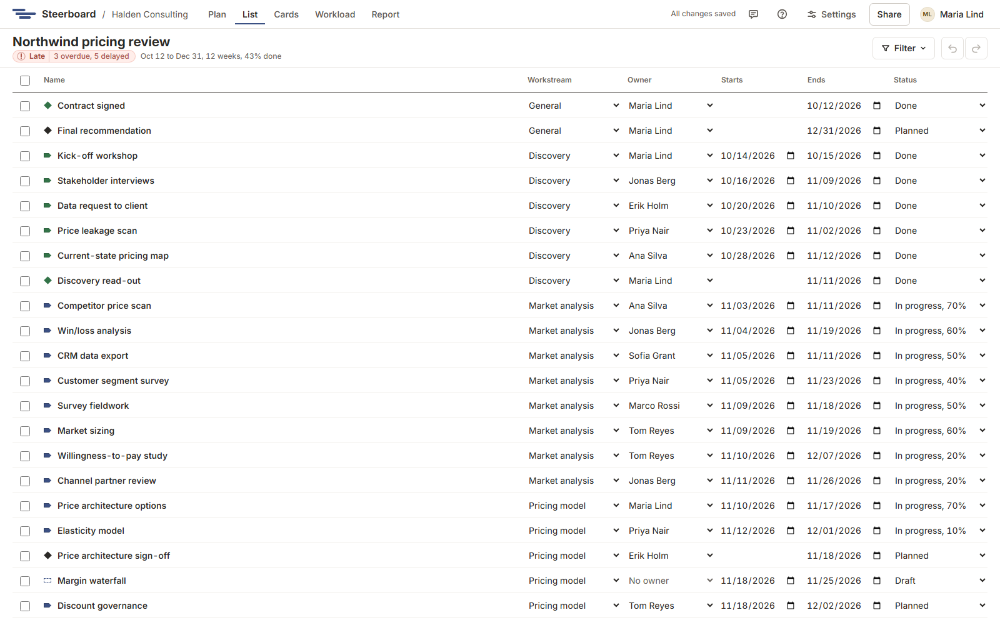

# List

**List** shows the plan as a list: a line for each activity and milestone, to
read down, sort, type into and paste into. It's the same plan as the board's,
so what you change here has changed there.

Each line has the item's **Name**, **Workstream**, **Owner**, when it **Starts**
and **Ends**, and its **Status**. The mark before the name is the one the plan
draws: a boat for an activity, a diamond for a milestone, dashed while it's a
draft and green when it's done. A milestone has one date, under **Ends**. A
work package isn't a line of its own; the name of the package an item is in
follows the item's name.

The lines come in the plan's order: workstream by workstream, each by when it
starts. Choose a column's heading to sort by it, again for the other way round,
and a third time for the plan's order. **Filter** works as on the plan.

## Type in a line

If you can change the plan, every line is a row of boxes:

- Type a new name and press <kbd>Enter</kbd>, which also takes you to the line
  below.
- Choose another workstream or owner.
- Change a date. Dates follow the plan's working days, as in the
  [details panel](plan/details.md): a start or an end on a day off moves to a
  working day.
- Choose a status. A draft's only choice is **Planned (agree its dates)**:
  dates are agreed before work starts. See
  [Agreed dates and delays](plan/agreed-dates.md).

Each change is one step for undo.

## Add a line

The last line is for the next item. Choose **Activity** or **Milestone**, type
its name and press <kbd>Enter</kbd>. The cursor stays there, so you can type
one after the other.

A new line is a draft. An activity is five working days long, starting today
or on the next working day. It goes in the workstream of the line above it, or
in the workstream the filter shows.

## Paste from Excel

Copy rows in Excel (or any table) and paste them onto the list, or choose
**Paste rows…** and paste them in the box. Nothing is added yet: you see what
each row will become first, then choose the button that adds them. One undo
takes them all back.

- A single column is a list of names.
- With several columns, a first row of headings such as Name, Workstream,
  Owner, Start, End and Status says which is which. Without headings,
  Steerboard tells the columns from what's in them.
- Dates can be written the usual ways: 2026-11-30, 30/11/2026, 30.11.26,
  30 Nov 2026, Nov 30. With numbers only, the day comes first unless a date in
  the rows can only be read the other way.
- A row with both dates is an activity. A row with only the date it's due is a
  milestone. A row with only a start, or no dates, is an activity five working
  days long.
- A workstream the plan doesn't have is added. An owner is matched by name to
  the plan's team; someone who isn't on the team is left out, and the dialog
  says who.
- Rows that say they're done or in progress (a percentage counts) come in so,
  with their dates agreed. Everything else comes in as a draft.

Up to 500 rows are added at once.

## Change several lines together

Tick the lines. The panel beside the list then acts on all of them: agree
their dates, mark them done, give them to someone, move them to a workstream,
or delete them. The box in the heading ticks every line shown. Ticking one
line opens its [details](plan/details.md).

Ticked lines are the same selection as on the plan, so you can tick here and
carry on there.
