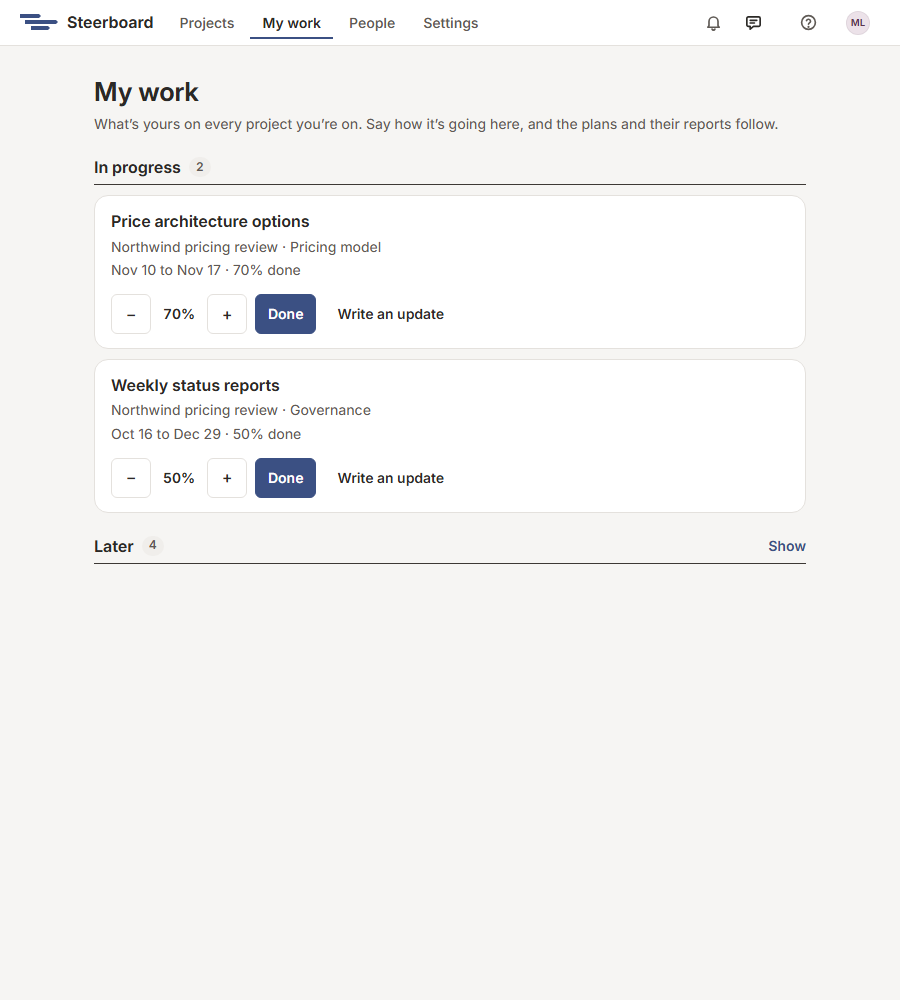

# My work

**My work** lists what's yours on every project you're on, in one place. It's
made for a phone, so you can keep your part of the plans current from
wherever you are. If you're a contributor, it's where you land when you sign
in; everyone else finds it beside **Projects** in the bar at the top, or in
the menu under their name.

Your work is in four groups:

| Group | What's in it |
|---|---|
| **Overdue** | Past its agreed end and not done, the most overdue first. |
| **In progress** | Started and not finished. |
| **Starting this week** | Starts within seven days, or should have started already. |
| **Later** | The rest, folded away until you open it. |

Each piece of work shows its project and workstream, its dates, how it stands,
and the latest update written on it. Choose its name to open it on the plan.

## Say how it's going

On each piece of work:

- **Start** starts it.
- **−** and **+** move its progress ten percent at a time.
- **Done** finishes it. It then drops off the list.
- **Write an update** opens a box for a few words on where it stands and why;
  **Add update** keeps them with your name and the day. See
  [Updates](plan/details.md#updates).

What you say here is a change to that project's plan, so its board, cards and
status report follow at once.

Work whose dates aren't agreed yet can't be started from here: the plan's
editors agree its dates first. If you can only view a project, its work is
listed without the buttons.

The weekly email about your work, where a project sends one, opens this page.
