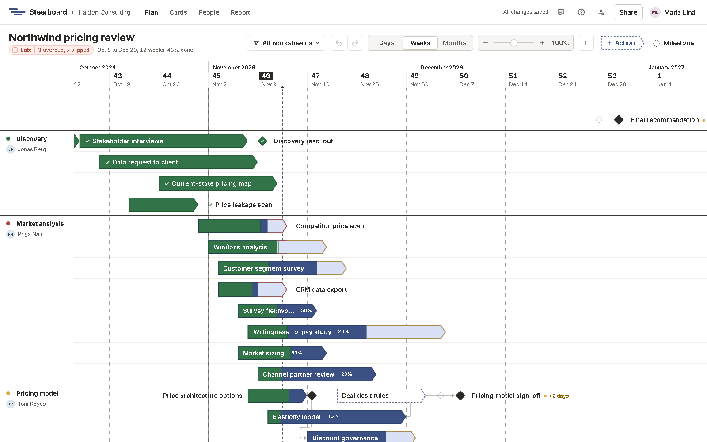

# The board

The board is the plan, drawn the way a consulting plan slide is: a stack of
rows under a time scale, lined off into workstreams.

## Rows

A row is a line on the board. It holds as many activities and milestones as
fit side by side, so a row reads as a flow: activity one, two and three, then
a milestone. Rows have no names of their own; what's on them carries the
names.

- Something you add next to an item lands on that item's row.
- When two items on a row overlap in time, one goes down a lane, so nothing is
  ever hidden. It stays in that lane until you drag it back up.
- Pulling across free space draws a box that selects everything it touches:
  see [select several](items.md#select-several). Hold <kbd>Alt</kbd> to draw
  a new activity instead.
- Dragging an item across others just moves it. Holding it still over another
  for a moment puts it inside that one, and dropping it in the box under a
  bracket puts it in that work package: see
  [work packages](workstreams.md#whats-in-a-work-package).
- A row that a drag or a delete empties closes up by itself, unless it's its
  workstream's only row.
- Below the last row there's always room to start a new one.

Right-click a row for **Add an empty row below** or, when it's empty,
**Remove this row**. **Arrange rows by work package** (right-click free space)
rebuilds the rows from the work packages within each workstream; undo puts your own
arrangement back.

## The time scale

Choose **Days**, **Weeks**, **Months** or **Quarters** in the toolbar for how
much time a column shows. Months are labelled in bold, then weeks by their
number with the Monday's date. On **Quarters** a year or two fits on one
screen: the quarters run along the top ("Q4 2026") and their months are the
columns.

- The board shows working days only. Saturday and Sunday take no room, so
  every week is five columns wide (or as many as the project's
  [working days](holidays.md)).
- Today is a dashed line down the board.
- [Holidays](holidays.md) are grey bands, named at the top.

## Fit and size

**Fit**, beside the time scale, shows the whole plan: it picks the time scale
and the size at which the plan fits across the screen, and puts its start at
the left. A long plan goes to months or quarters; a short one stays on days.

To set the size yourself, open **Show**. The slider beside **Size** makes
everything on the plan bigger or smaller, from 50% to 200%. Click the
percentage to go back to 100%. You can also hold <kbd>Ctrl</kbd> and scroll,
or pinch on a trackpad.

The size changes how big the plan is; Days, Weeks, Months and Quarters change
how much time a column is. Both are remembered in your browser.

## Find and filter

To go to an item by name, press <kbd>Ctrl</kbd>+<kbd>F</kbd> or choose the
magnifier in the toolbar, and type part of its name. The list shows what
matches, with its workstream and dates. <kbd>Enter</kbd> or a click takes the
board there and opens the item; the arrow keys move through the list.

**Filter**, in the toolbar, shows only some of the plan:

- The workstreams to show. See
  [Workstreams](workstreams.md#show-only-some-workstreams).
- **Whose work**: everyone's, **My work**, or one person's.
- **How it stands**: **Overdue**, **Delayed**, **Draft** or **Done**, any of
  them together.

With whose work or how it stands chosen, the rest of the plan fades and stays
where it is, so the plan keeps its shape. The button turns blue and counts
what's on; **Show all** clears everything. These two aren't kept when you
leave the plan.

On a laptop-wide window the toolbar's buttons give up their words so the
plan's name keeps its room: **Filter** is its funnel and **Show** is its eye.

## What the plan shows

The two arrows beside the magnifier list what changed on the plan since the
last report, and can draw where each moved item was: see
[What changed](changes.md).

**Show**, in the toolbar, has three things:

- **Owners** writes each item's owner after its name, as initials. See
  [names](items.md#names).
- **Key** puts a small list at the bottom right of the board: the marks this
  plan is drawn with, and what each is called. Point at one to read what it
  means; its × closes it. See [The marks](../reference/marks.md).
- **Size**, as above.

All three are kept in your browser. Viewers have them too.

## Looking around

Scroll, drag the time scale, or hold the right mouse button and pull. A
right-click without moving still opens the menu.

## Who can change it

Owners and editors can change the plan. Viewers see exactly the same board,
without the handles: they can't drag, stretch or rename anything.
