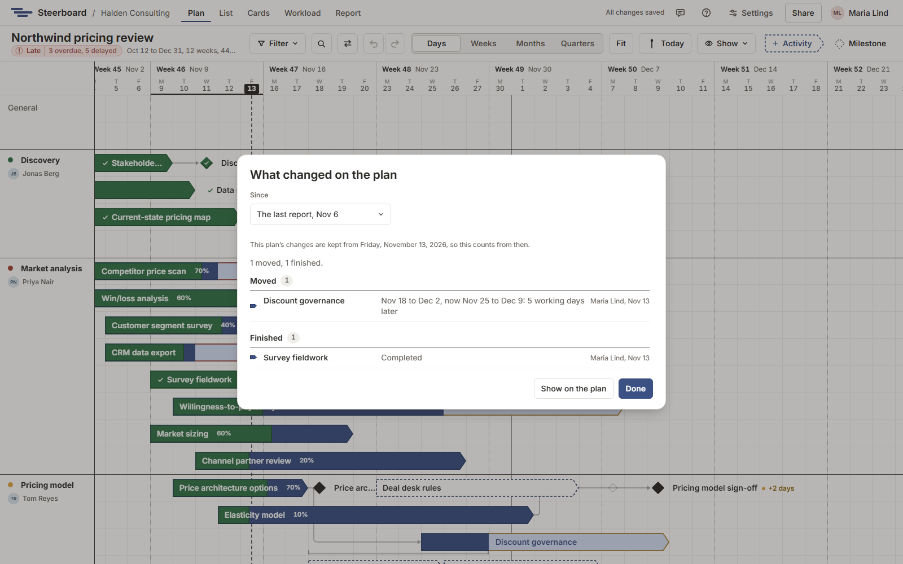

# What changed

"What's different from last week?" The button with two arrows beside
**Filter** and the magnifier, on the plan, answers it: **What changed on the plan**.

Under **Since**, choose **The last report** or **A day…** and pick the day.
With no report issued yet, it counts from a day, a week ago to begin with.

The changes are listed by kind:

| Kind | What it says |
|---|---|
| **Moved** | The old dates and the new, and how many working days later or earlier. |
| **Added** | Its dates, and whose it is. |
| **Finished** | The day it was completed. |
| **Dates agreed** | The dates a draft was agreed for. |
| **Agreed dates changed** | What was agreed before, and what is now. |
| **Given to someone else** | Who had it, and who has it now. |
| **Reopened** | It was done, and isn't now. |
| **Removed** | Where it was. |

Each line names who changed the item last, and when. Choose an item's name to
go to it on the plan. An item can be under several kinds: moved, and given to
someone else. Work packages aren't listed, since they follow what's inside
them. Moving an item to another row, or writing in its notes, doesn't count.

## See it on the plan

**Show on the plan** closes the list and draws a faint dashed outline where
each moved item was, on its row. The button stays pressed while the outlines
are there; open the list again and choose **Stop showing on the plan** to take
them away. The outlines are only a way of looking: they aren't saved, nobody
else sees them, and they aren't on the slides.

## How far back it goes

Steerboard keeps how the plan stood when the project was made and each time a
report is issued, and every change since. For a project made before this
arrived, changes are counted from the day it did; the list says so when you
ask for an earlier day.

Everyone who can open the project can see what changed.
