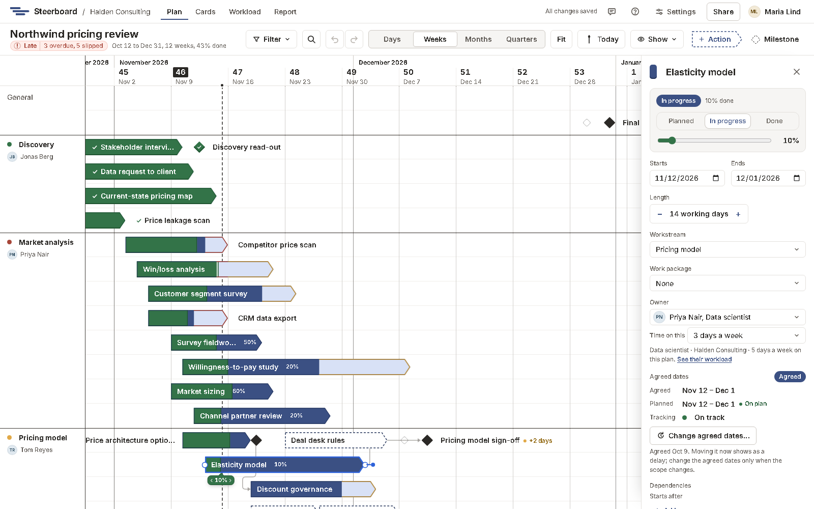

# The details panel

Click an item to open its details on the right. Everything you can do on the
board can also be done here, with the keyboard and in words.

What you can change depends on your role on the project. Viewers read the
panel. [Contributors](../sharing/sharing.md#contributors) can say where their
own work stands and write its notes. Editors and owners change everything.

Under the name, first, is where it stands: **Draft**, **Planned**,
**In progress** or **Done**, how it's tracking (late or delayed, with by how
much), and what's next. A draft has its **Agree** button there: it must be
agreed before it can start. Agreed work has its status there (**Planned**,
**In progress** or **Done**) and a progress slider, in steps of 10%.

| Field | What it does |
|---|---|
| Name | Click the title to rename it. |
| **Starts** and **Ends** | The planned dates. Typing a start after the end moves the whole item there, keeping its length. A weekend date moves to the next working day. |
| **Length** | In working days; − and + change it. |
| **Workstream** | Moves the item to a row in another workstream. |
| **Work package** | Puts the item in a work package, or takes it out of one. It moves onto the package's rows, or off them. |
| **Owner** | Who does it, picked from the project's team. A work package's owner is its lead. For someone who isn't on the team yet, choose **Someone not on the team…** at the end of the list: it opens the project's [people](../sharing/sharing.md#add-people) to add them. |
| **Time on this** | How much of the owner's week it takes: full time, 3 days a week, a day a week, and so on (in shares of the week when the project's [working days](holidays.md) aren't five). |
| **Agreed dates** | For agreed work: the agreed and planned dates, and how it's tracking. **Change agreed dates…** for a change of scope. |
| **Completed on** | For finished work: the day it was finished, which can be corrected. |
| Starts after, Followed by | Its [links](links.md), with **Add** and ×. |
| Notes | Anything worth keeping with the work. |
| Updates | A few words on where it stands and why, each kept with your name and the day. See [Updates](#updates). |
| History | Changes to its agreed dates, with reasons, and corrected completion days. |

## Updates

Under the notes, write where the work stands and why: "Waiting for client
data, chased Tuesday". Press <kbd>Enter</kbd> or choose **Add update**. Each
update is kept with your name and the day, newest first, and isn't rewritten
afterwards; undo takes back one you just wrote.

To name someone on the team, type @ and start their name, then choose it from
the names offered. They're marked in the update.

The latest update on work that's overdue or delayed goes beside it in the
[status report](../report/index.md#the-detail), so the reason is next to the
delay.

Select several items and the panel offers what you can do to all of them at
once, such as agreeing their dates, marking them done, giving them to
someone, moving them to a workstream or deleting them. See
[select several](items.md#select-several). Lines ticked on the
[List](../list.md) are the same selection.

Press <kbd>Escape</kbd> or the ×, or click anywhere on the plan that isn't
an item, to close it. Viewers see the same panel, read-only.
