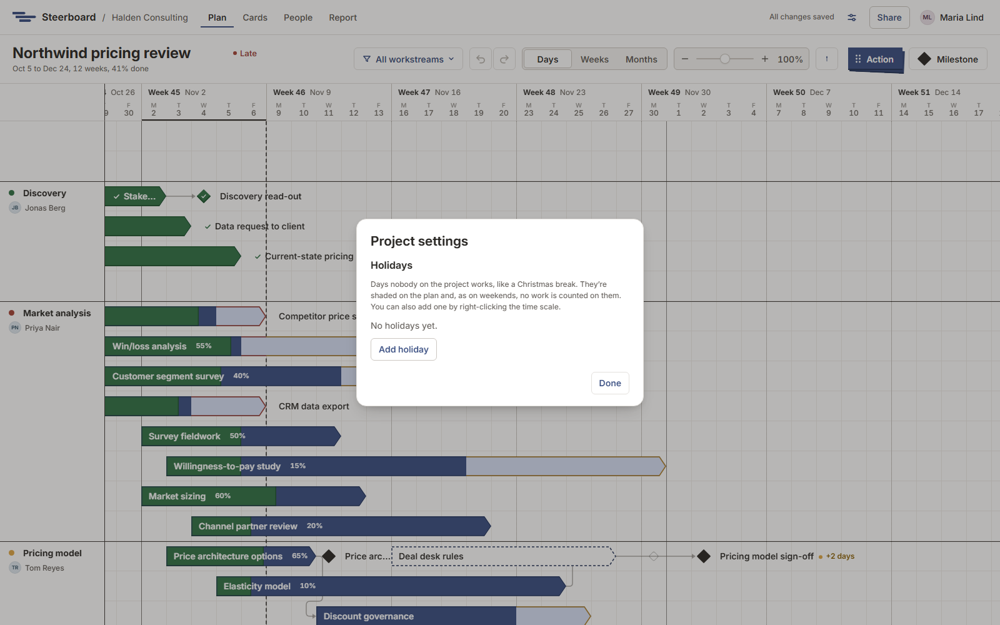

# Holidays

Holidays are days nobody on the project works, such as a Christmas break or a
public holiday. They're shaded grey down the board, with their name at the
top, and no work is counted on them.

## Add one

- Right-click the time scale, or an empty part of the board, and choose
  **New holiday…**. It starts on the day you clicked and runs a week; change
  its name and dates there.
- Or open **Project settings** (the sliders icon beside **Share**) and choose
  **Add holiday**.

## Change or delete one

Right-click it on the time scale to edit or delete it, or use
**Project settings**, where all of the project's holidays are listed.

## What they do to the plan

As on weekends, no work is counted on a holiday's days:

- An activity running over a holiday keeps its dates and has fewer working days.
- Anything starting, ending or falling on a holiday moves out of it: a start
  to the first working day after, an end back to the last working day before.
- Unlike weekends, a holiday keeps its columns on the board, so work across it
  gets wider.

The plan slide in the [report](../report/present.md) shades holidays too.
