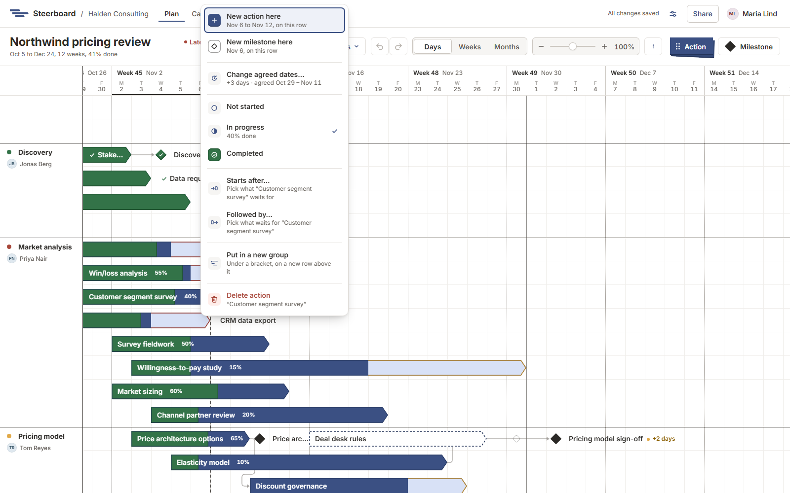

# Activities and milestones

An *activity* (an action) is work that takes time. It's drawn as a boat:
square at the start, pointed at the end. A *milestone* is a moment, such as a
sign-off or a steering committee. It's drawn as a diamond.

## Add one

| To add | Do this |
|---|---|
| An activity | Right-click free space on a row and choose **New action here**. Or draw across free space on a row. Or drag **Action** from the toolbar onto the board, or click it to add one on a new row at the bottom. |
| A milestone | Right-click a spot on a row and choose **New milestone here**, or drag **Milestone** from the toolbar onto the board. |
| A new row | Draw or right-click in the space below the rows, or drop something on the line between two rows (a blue line shows where). |

A new activity lasts one working week unless you draw it to size. Type its
name straight away; <kbd>Enter</kbd> keeps it.

Everything you add starts as a draft, pencilled in with a dashed outline,
until you [agree its dates](agreed-dates.md).

## Move and resize

| To | Do this |
|---|---|
| Move it in time | Drag it left or right. |
| Move it to another row | Drag it up or down. The row lights up and an outline shows where it lands. Drop it on the line between two rows for a new row there. |
| Change an activity's dates | Drag either end. Milestones have a single date. |
| Rename it | Double-click it, or select it and press <kbd>Enter</kbd>. The name becomes editable where it is. |
| Delete it | Right-click it and choose **Delete action** (or **Delete milestone**), drop it on the bin that appears while you drag, or press <kbd>Delete</kbd>. |

What you drag is what you get: the edge you hold follows the pointer column by
column, a tip shows the dates, and when you let go it stays where it was
shown. Nothing else on the board moves by itself, except work that
[waits for it](links.md) when it would otherwise start too early.

Starts, ends and milestones always fall on working days.

## Select several

<kbd>Ctrl</kbd>-click or <kbd>Shift</kbd>-click items to select several. You
can then drag them together, agree their dates or mark them done from the
details panel, or right-click for **Group** to put a bracket over them.

Click blank canvas, or press <kbd>Escape</kbd>, to deselect.

## Names

Every name shows somewhere it can be read, and never over anything else:
inside the item when it fits, otherwise beside it, otherwise shortened with
"…". Point at an item to see its whole name.

## Undo

<kbd>Ctrl</kbd>+<kbd>Z</kbd> undoes and <kbd>Ctrl</kbd>+<kbd>Shift</kbd>+<kbd>Z</kbd>
redoes, or use the arrows in the toolbar. Undo only takes back your own
changes, never someone else's.
