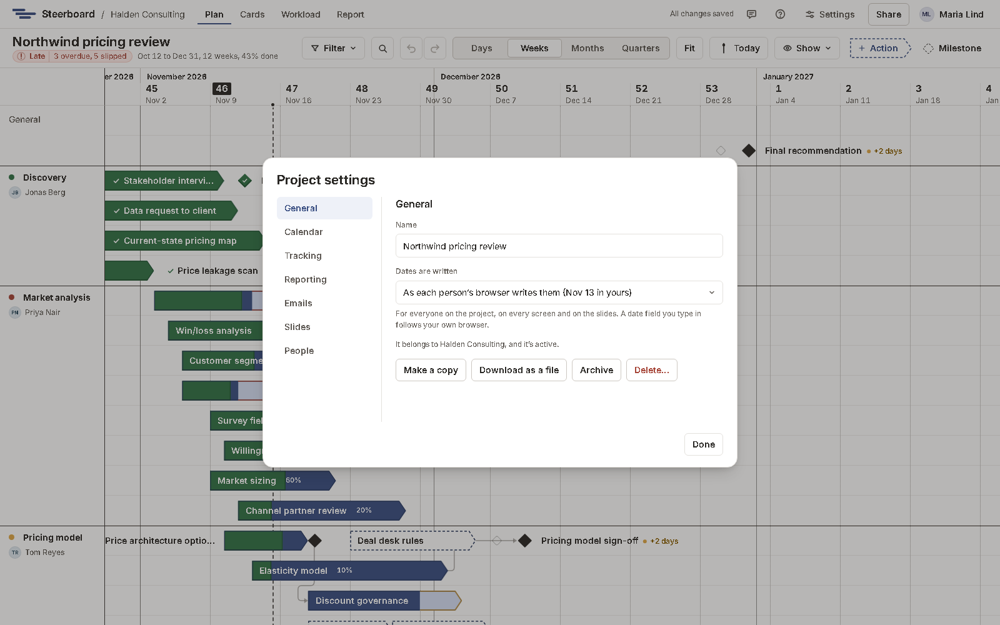

# Project settings

Everything about a project is in one place: open a project and choose the
sliders icon beside **Share**. Everyone with the project can look; editors
change what belongs to the plan, and owners the rest.

| Tab | What's there |
|---|---|
| **General** | The project's name; how its dates are written (**Dates are written**: in one language and order for everyone, on every screen and on the slides, or as each person's browser writes them); the group it belongs to; and what happens to it: **Make a copy**, **Download as a file**, and for its owners **Archive** and **Delete…**. |
| **Calendar** | **Working days**: the days of the week the project works. And its holidays. See [Working days and holidays](plan/holidays.md). |
| **Tracking** | When a workstream, a work package and the plan as a whole count as at risk or late. See [Agreed dates and delays](plan/agreed-dates.md#when-the-plan-is-at-risk-or-late). |
| **Reporting** | When the last status report was issued, so the next one covers from then to today. **Issue report…** on the report moves it on; set it here to start the period on another day. And how often **A report is due**, with a reminder by email. See [below](#a-report-on-a-rhythm). |
| **Emails** | What the project emails about its work. See [below](#emails-about-work). |
| **Sharing** | Who can open the project and what they can do. See [Sharing a project](sharing/sharing.md). |

## A report on a rhythm

Under **Reporting**, **A report is due** every week, every two weeks or every
month, counted from the day the last one was issued (before any has been,
from the plan's first day). The tab and the report then say when the next one
is due.

With **Email the project's owners when one is due** ticked, each owner who
signs in gets one email on the morning of that day, with a link to the report.
Issuing the report sets the next due day.

## Emails about work

Under **Emails**, a project's owners choose what it sends. Everything is off
until they turn it on.

| Email | When |
|---|---|
| **When work is given to someone** | A few minutes after they're made its owner, with everything that became theirs in one email. Not for work you take yourself, and not if it's taken back, finished or deleted in those minutes. |
| **When someone's work goes overdue** | Once, the morning after its agreed end has passed without it being done. |
| **Each person's week** | On the first working morning of the project's week: what's overdue, in progress, starting and due. Nothing to someone with nothing. |

They go to people on the project's team who sign in and can open it, at the
address they sign in with. People who don't sign in get none. Anyone can stop
their own under **Settings**, with **Email me about my work**.

