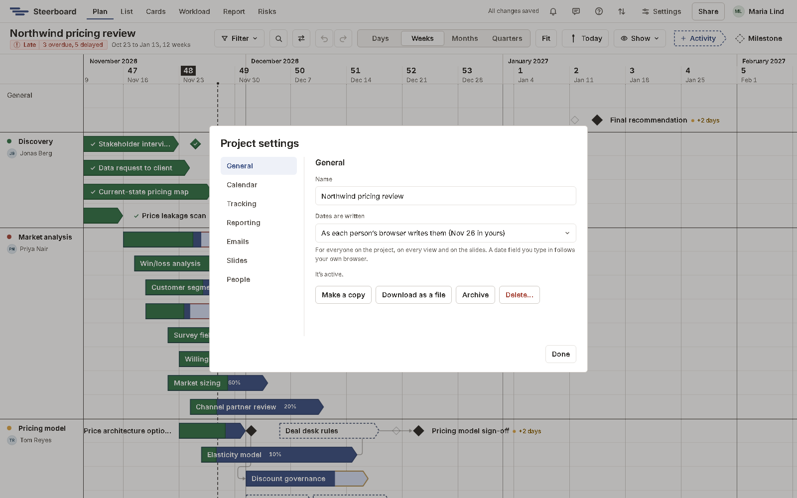

# Project settings

Everything about a project is in one place: open a project and choose
**Settings** beside **Share**. Everyone with the project can look; editors
change what belongs to the plan, and owners the rest.

| Tab | What's there |
|---|---|
| **General** | The project's name; how its dates are written (**Dates are written**: in one language and order for everyone, on every view and on the slides, or as each person's browser writes them); the group it belongs to; and what happens to it: **Make a copy** (for planners and account managers, as a copy is a new project), **Download as a file** (saved under the project's name), and for its owners **Archive** and **Delete…**. |
| **Calendar** | **Working days**: the days of the week the project works. And its holidays. See [Working days and holidays](plan/holidays.md). |
| **Tracking** | Whether new work has its dates agreed as it's added, whether delays and overdue work are tracked and how they're drawn, and when a workstream, a work package and the plan as a whole count as at risk or late. See [Agreed dates and delays](plan/agreed-dates.md#when-the-plan-is-at-risk-or-late). |
| **Reporting** | When the last status report was issued, so the next one covers from then to today. **Issue report…** on the report moves it on; set it here to start the period on another day. And how often **A report is due**, with a reminder by email. See [below](#a-report-on-a-rhythm). |
| **Emails** | What the project emails about its work. See [below](#emails-about-work). |
| **Colours** | The colours the plan is drawn in: one for activities, one for milestones and brackets. See [below](#the-projects-colours). |
| **Slides** | Who the report is for, your own logo, and a client’s PowerPoint template to make the slides in. See [below](#your-own-slides). |
| **People** | The project's team, and who can open the project and what they can do. See [Sharing a project](sharing/sharing.md). |

## A report on a rhythm

Under **Reporting**, **A report is due** every week, every two weeks or every
month, counted from the day the last one was issued (before any has been,
from the plan's first day). The tab and the report then say when the next one
is due.

With **Email the project’s owners when one is due** ticked, each owner who
signs in gets one email on the morning of that day, with a link to the report.
Issuing the report sets the next due day.

## Emails about work

Under **Emails**, a project's owners choose what it sends. Everything is off
until they turn it on.

| Email | When |
|---|---|
| **When work is given to someone** | A few minutes after they're made its owner, with everything that became theirs in one email: work, and [risks, issues and decisions](risks.md). Not for what you take yourself, and not if it's taken back, finished or deleted in those minutes. |
| **When someone’s work goes overdue** | Once, the morning after its agreed end has passed without it being done. |
| **Each person’s week** | On the first working morning of the project's week: what's overdue, in progress, starting and due. Nothing to someone with nothing. Its button opens [My work](my-work.md). |

They go to people on the project's team who sign in and can open it, at the
address they sign in with. People who don't sign in get none. Anyone can stop
their own under **Settings**, with **Email me about my work**.

Emails are part of the account's [subscription](sharing/settings.md#the-subscription).
On a tier without them the boxes can't be ticked, a report isn't sent by email
when it's issued, and a project that had some turned on sends none.

## The project's colours

Under **Colours**, anyone who can edit the project picks the colours its plan
is drawn in: on every view, in the report, in presentation mode and on the
downloaded slides. Like the logo and the template, they're part of the
account's [subscription](sharing/settings.md#the-subscription).

| | |
|---|---|
| **Activities** | Each activity is drawn in it, with a darker outline. Its part past the agreed end is a light tint of the same colour, and the box under an open work package a faint wash of it. |
| **Milestones and brackets** | Milestones' diamonds and work packages' brackets. |

Pick a colour with the swatch, or type or paste its code, such as #0072ce. The
drawing beside them shows the plan in those colours. **Use Steerboard’s** puts
Steerboard's navy or black back.

Green, amber and red still mean done, delayed and overdue, so Steerboard won't
take a colour that could be read as one of them: any green, or a clear amber or
red. Names on activities are white, so the activities' colour has to be dark
enough to read them on; milestones and brackets have to show on the white plan.
The field says why when it doesn't take a colour.

Steerboard's logo, links and buttons keep Steerboard's colours, and so do the
views that span projects: the programme's timeline and My work.

### A template's colours

When you upload a template under **Slides**, Steerboard reads its theme's
colours and asks whether to use them: for activities the first of its accent
colours that can be used, for milestones and brackets its dark colour.
**Use the template’s colours** sets them, and **Keep the current colours**
leaves the plan as it was. **Colours** keeps offering them as long as the
template is there and the plan is in other colours.

## Your own slides

Under **Slides**, anyone who can edit the project sets how its status report's
slides look. The logo and the template are part of the account's
[subscription](sharing/settings.md#the-subscription): on a tier without them
they show locked, and the slides are Steerboard's own.

| | |
|---|---|
| **Client** and **Reference** | Who the report is for, and a project or engagement number. Both go on the cover, under the period. |
| **Logo** | **Upload a logo…** takes a PNG or JPEG of up to 500 KB. It takes the place of Steerboard's logo on every slide, downloaded and in presentation mode, as big as fits where the logo goes. **Replace logo…** and **Remove logo** change it. |
| **PowerPoint template** | **Upload a template…** takes a client's or your firm's .pptx or .potx of up to 9.5 MB. The downloaded slides are then made in it. |

### A client's template

Steerboard reads the template as you upload it and says what it found: its
slide size, its title slide, and the layout the slides will be made on. That
is the emptiest layout with a title, usually the one called "Title only". If
another suits better, pick it under **Slides are made on**.

In the downloaded slides every one is then one of the template's own. The
cover is on its title slide and the rest on the layout you chose, with each
slide's title in the template's own place and type, and Steerboard's content
scaled into the room under it. The template's sample slides are left out. Its
masters, colours, fonts, logo and footers stay, and Steerboard's band, logo
and footer aren't drawn.

- The content is set in the template's own font when it's one Steerboard
  knows the widths of: Arial, Calibri, Aptos, Segoe UI, Verdana, Tahoma,
  Georgia, Times New Roman and others like them. It's laid out so it still
  fits on a computer that doesn't have the font. In any other font the
  content is set in Arial. The line under the template's name says which.
- The content is drawn in [the project's colours](#the-projects-colours), the
  same in every template.
- There's no slide size to choose: the template has its own.
- A file with macros (.pptm, .potm) can't be used. Save it as a .pptx first.
- A template too big to upload usually fits once its sample slides and the
  pictures it doesn't use are taken out.
- **Present** keeps Steerboard's own layout, with your logo and the project's
  colours.
- **Replace template…** and **Remove template** change it, or go back to
  Steerboard's slides.

