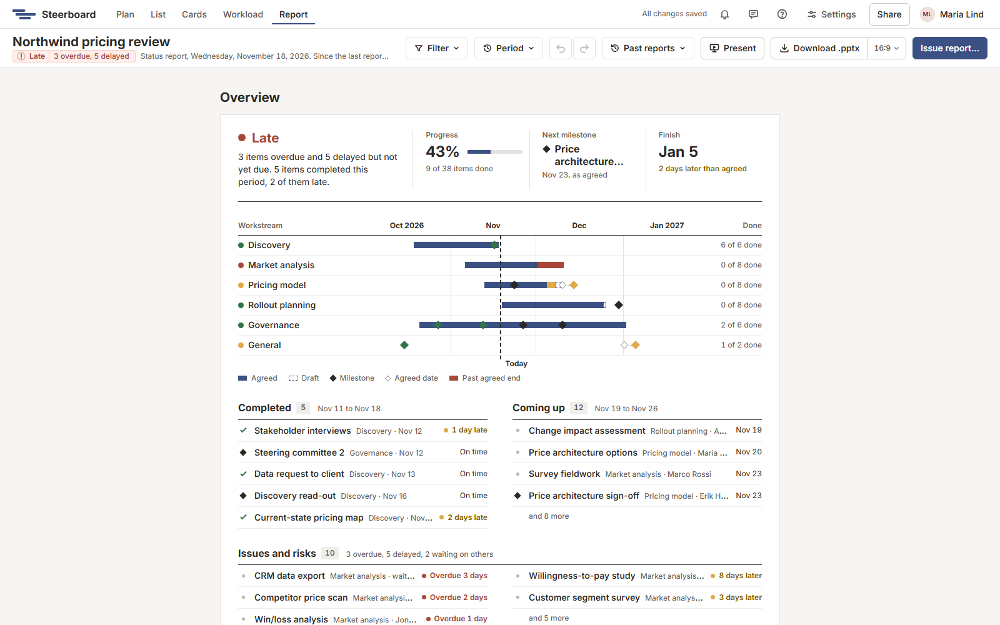

# The report

**Report** is the status report, written from the plan. It covers the period
since the last report was issued (the last 7 days at first) and looks ahead as
far again, unless you [set its period](#the-period). It's worked out from the
plan: change the plan and the report changes with it. What the plan can't say
for itself, you write on it: see [Your words](#your-words).

It reads from the top: **Overview**, **Commentary**, then **Off plan** and
**Milestone dates** as pictures, and **In detail** last, with the lists folded.

## The status on one page

A name in the report (an entry in a list, a milestone on the timeline, a
line in a table) opens [that item's details](../plan/details.md) beside the
report.

**Overview** is the page a status meeting starts from:

- The overall status, and what it was when the last report was issued ("Was on
  track on Nov 19").
- The headline: your first key message, or a sentence worked out from the plan
  when you haven't written one. Under it, the finish against what was agreed
  and how much is done.
- **Needs you**: the decisions still open in the project's log, soonest first,
  with who decides and by when.
- A row for each workstream: its status; a bar of how much of its work is
  done, with a tick where it should be by today going by the agreed dates; its
  next milestone and the date; and how that date stands, as agreed or so many
  days later.
- **Done**, **Due** and **Late** across the bottom: what was completed in the
  period, what's due in the next one, and what's overdue or delayed. Each
  shows its count and the first few, and "and 4 more" opens the full list
  further down.

## Your words

Under **Commentary**, anyone who can edit the plan writes what the plan can't say.
Each is one line: type it where it stands, and it's kept when you leave the
field. Empty a line, or press its ×, to take it out.

- **Key messages**: what the reader should take from this period.

Below them the report lists what's in the project's
[log of risks, issues and decisions](../risks.md), kept in the **Risks** view
(**Open Risks** goes there):

- **Decisions needed**: who decides and by when, soonest first. A date gone by
  shows in red.
- **Decided since the last report**, with what was decided.
- **Risks and issues**: the high risks, the open issues, and any other one
  ticked **In the report**, each with its rating, owner and what's being done.
  One closed since the last report says so, once.

They're on the slides too, right after the status summary. The status itself
is still worked out from the plan: your words explain it, and never change it.
Viewers and contributors read them.

## Off plan

**Off plan** is a picture of the work that isn't going as planned: what moved,
is new or is gone since the last report, and what's overdue or delayed. Each
has a row of its own under its workstream. A dashed outline shows where it was
at the last report, and its bar or diamond where it is now. Late work is drawn
as on the board, the part past its agreed end in light blue, outlined red when
it's overdue and amber when it's delayed. On the right it says what happened,
such as "4 working days later" or "Overdue 3 days". The changes count from when
the last report was issued, or from the first day of the
[period](#the-period) when there's none yet.

## Milestone dates

Once the project has issued a report, **Milestone dates** shows how each
milestone's date has moved, report by report: the days of the last five
reports and today along the bottom, dates up the side, and a line for each
milestone. A flat line means its date held; a rising one means it moved later
at that report. The dashed diagonal is where a milestone's date meets the
report's day, and one that's done ends there as a black diamond. Each line says
its date at the end, and how far it moved since the first report shown.

## The detail

**In detail** has the lists behind the pictures, each folded with its count:
open one to read it. They are every change since the last report (adding dates
agreed, work given to someone else and work reopened), work completed this
period, overdue work, work that is delayed but isn't due yet, agreed work due
next period, and upcoming drafts, labelled as not agreed yet. Every list of
work says whose it is, under **Owner**. Drafts never appear as delays.

Where someone has written an [update](../plan/details.md#updates) on work
that's overdue or delayed, the latest one is beside it, with who wrote it and
the day: under the item on the status page, and in the tables' last column.

## Overall status

| Status | Means |
|---|---|
| On track | All agreed work is on plan. |
| At risk | Some agreed work is planned to end later than agreed, but nothing is overdue. |
| Late | Some agreed work is past its agreed end and not done. |

A workstream's status is the worst of the agreed work in it, and the plan's is
the worst of its workstreams.

## Issue the report

When you've sent the report, choose **Issue report…**. That keeps the report
as it is now and closes the period, so the next report starts from today. Its key messages go with it. The
log stays as it is: what's still open is in the next report too, and what was
decided or closed this period isn't said again.

Where your Steerboard sends email and the account's [subscription](../sharing/settings.md#the-subscription)
includes emails, the dialog has **Send it to**: everyone
else who can open the project, to tick or leave. Those you tick each get an
email with how the plan stands, the key messages, a few words from you if you
write any, and a link to the report as you issued it. The people it went to
last time are ticked again; nobody is ticked the first time, and nothing is
sent unless you tick someone.

A project can put the report on a rhythm (every week, two weeks or month) and
remind its owners by email when one is due: see
[Project settings](../project-settings.md#a-report-on-a-rhythm). The line under
the project's name then says when the next one is due.

Issuing reports is part of some tiers. On a tier without it, **Issue report…**
can't be pressed and **Past reports** says it isn't part of the subscription.
The report on screen still covers its period, which you move on under
**Last report issued on** in the project's settings. See
[The subscription](../sharing/settings.md#the-subscription).

## Past reports

**Past reports**, beside the report's actions, lists every report that has
been issued, newest first: its day, the status, how much was done, and the
finish with how far it has moved since the report before. Above the list, a
dot for each report shows how the status has run, and where the finish started
and has got to.

Choose a day to open that report as it was. You can read it, present it and
download its slides; **Back to today’s report** returns. Everyone who can
open the project can read them. **Send it…**, on the line above an opened
report, sends that one by email, to people you tick as when issuing.

A kept report never changes, whatever happens to the plan afterwards. Undoing
an issue reopens the period and leaves the report in the list. A copy of a
project starts with none.

## The period

**Period**, in the report's toolbar, sets what the report covers. Those who
can edit the plan change it, and it's the same for everyone on the project
and on the slides.

- **Looks back**: since the last report, 1, 2 or 4 weeks, since a milestone
  that has passed, or **Since a date…** with a day you choose.
- **Looks ahead**: as far as it looks back, 1, 2 or 4 weeks, **To a date…**, or to a milestone
  that's still to come. When that milestone moves, the period moves with it.

The panel says which days the two periods come to today.

## Only some of the work

The filter beside the report's actions narrows the report, and its slides, to
the workstreams you pick. See
[Workstreams and work packages](../plan/workstreams.md).

**Changed since**, in the same filter, shows only the work that changed since
the last report, or since 1, 2 or 4 weeks ago. It's for looking: a report you
issue is always the whole of it.

## Next

[Present and download](present.md)
