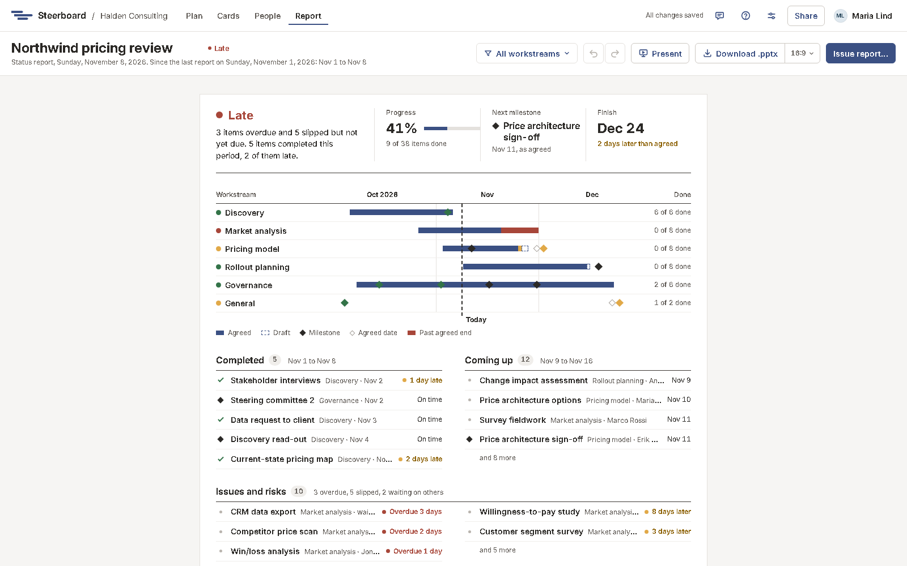

# The report

**Report** is the status report, written from the plan. It covers the period
since the last report was issued (the last 7 days at first) and looks ahead to
the next one. Nothing in it is typed by hand: change the plan and the report
changes with it.

## The status on one page

The report opens with the page a status meeting starts from:

- **Facts** across the top: the overall status in a few words and one
  sentence, progress, the next milestone and the finish, each against what was
  agreed.
- A timeline of the workstreams: agreed work as a navy bar, drafts outlined
  in dashes, the part past the agreed end in amber or red, milestones as
  diamonds (an empty one where a moved milestone was agreed), and today.
- **Completed** on the left and **Coming up** on the right.
- **Issues and risks** along the bottom: overdue work, slipped work, and work
  waiting on someone outside the team, each listed once.

Long lists show the first few and say how many more there are.

## The detail

Then, in full: the workstreams; work completed this period, on time or late;
overdue work with its owner; work that has slipped but isn't due yet; agreed
work due next period; and upcoming drafts, labelled as not agreed yet. Drafts
never appear as delays.

## Overall status

| Status | Means |
|---|---|
| On track | All agreed work is on plan. |
| At risk | Some agreed work is planned to end later than agreed, but nothing is overdue. |
| Late | Some agreed work is past its agreed end and not done. |

A workstream's status is the worst of the agreed work in it, and the plan's is
the worst of its workstreams.

## Issue the report

When you've sent the report, choose **Issue report…**. That closes the period,
so the next report starts from today.

## Only some workstreams

The workstream filter beside the report's actions narrows the report, and its
slides, to the workstreams you pick. See
[Workstreams and work packages](../plan/workstreams.md).

## Next

[Present and download](present.md)
