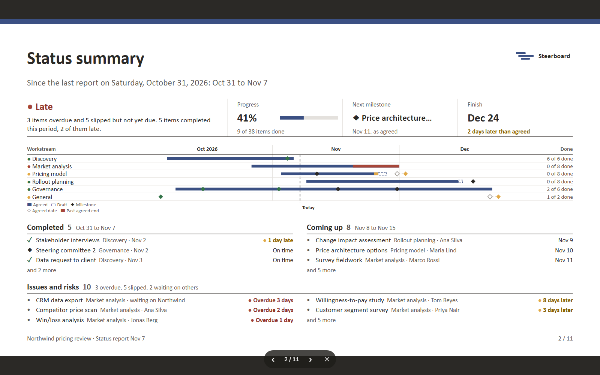

# Present and download

The report becomes slides in two ways, both from the same report:
**Present** shows them full screen, and **Download .pptx** gives you an
editable PowerPoint deck.

## Present

Choose **Present** on the **Report** screen. Move with the arrow keys,
<kbd>Page Up</kbd> and <kbd>Page Down</kbd>, <kbd>Space</kbd>, or a click.
<kbd>Escape</kbd> leaves.

## Download .pptx

Choose **Download .pptx**. The deck is native PowerPoint, so you can edit
everything in it:

- A title slide, then the status on one page, drawn with real text boxes and
  shapes.
- The plan as a think-cell style Gantt chart, drawn as on the board.
- The detail as real tables. Long lists carry on onto extra slides.

What makes up one thing (an activity's bar, its done part and its name; a
milestone and its name; the legend) is a PowerPoint group, so you can move it
by hand as one. Moving things in PowerPoint doesn't change the plan.

The slides use Calibri, so they look right on any machine, and the plan's navy
as a thin band along the top. The Steerboard logo sits top right.

## Slide size

The part of the button showing **16:9** picks the slide size: 16:9, 16:10, A4
or 4:3, to match the template the slides are going into. Everything is laid
out again for the size you pick, and the choice is remembered in your browser.
Presenting is always 16:9.

## The plan slide

The plan slide draws the board as it is: workstreams down the left with their
leads, each row in its lanes, under a two-tier time scale that fits the plan's
length (weeks over days for a few weeks, up to years over quarters for a
programme). Activities are pentagons in navy, what's done in green, late work
in light blue outlined red or amber, drafts dashed. Groups are brackets,
milestones diamonds with their dates, holidays grey bands, and today a dashed
line. A plan too tall for one slide carries on over more, a workstream at a
time.
