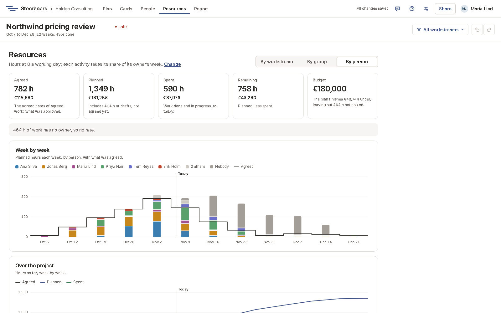

# Resources: hours and costs

**Resources** shows the hours the plan takes and what they cost: what was
agreed, what's planned now and what's been spent, against a budget. Use it to
scope a project, to get it approved, and to keep it on track.

## Where the hours come from

Every activity has an owner and takes a share of their week: its **Time on
this** in the [details panel](plan/details.md), such as 3 days a week. On each
of its working days it takes that share of a day, and a day is the project's
hours in a working day: 8 unless you change it in
[Project settings](project-settings.md). Weekends and
[holidays](plan/holidays.md) count no hours; milestones take none; a work
package counts only through the work inside it.

An activity of two weeks, at 3 days a week, 8 hours a day, is 48 hours.

## Agreed, planned and spent

| Figure | What it counts |
|---|---|
| **Agreed** | The [agreed dates](plan/agreed-dates.md) of agreed work: what was approved. Drafts have none. |
| **Planned** | The dates as they are now, drafts included, with late work running on to today: what it will take. The figure says how much of it is drafts, not agreed yet. |
| **Spent** | Work done, from its start to the day it was finished, and work in progress from its start to today. Work not started has spent nothing, even if its start has passed. |
| **Remaining** | Planned, less spent. |

Planned more than agreed means the work has grown since it was approved, or
there are drafts still to agree.

## Budget

Set a budget in hours, in money or both under **Resources** in
[Project settings](project-settings.md). **Budget** then says how far over or
under the plan finishes, and the chart **Over the project** draws the budget as
a line to see the planned hours against it. A verdict in money leaves out hours
that aren't costed, and says so.

## By workstream, group or person

Choose **By workstream**, **By group** or **By person** to break it all down:
the chart **Week by week** stacks each week's planned hours by line, with what
was agreed drawn over them, and the table below has each line's hours and costs.
Work nobody owns is a line of its own.

By person, the table has **Their time**: the hours their days a week on the
project give over the weeks it has work. More planned than that is marked in
red: they're over-planned somewhere. [People and workload](people.md) shows
which days.

The [workstream filter](plan/workstreams.md) applies here too.

## Hourly rates and costs

By person, the project's owners set each person's hourly rate in the table:
type it and press <kbd>Enter</kbd>, or empty it to take it away. Every hour
then costs its owner's rate. Work nobody owns, or whose owner has no rate,
isn't costed, and the page says how many hours that is.

Rates and costs are only for the project's owners, unless an owner lets its
editors see them too, under **Who sees rates and costs** in
[Project settings](project-settings.md). Viewers never see them, so a client
you share the plan with as a viewer doesn't. They're kept apart from the plan
on the server, so they never reach anyone who may not see them. Everyone sees
hours.
