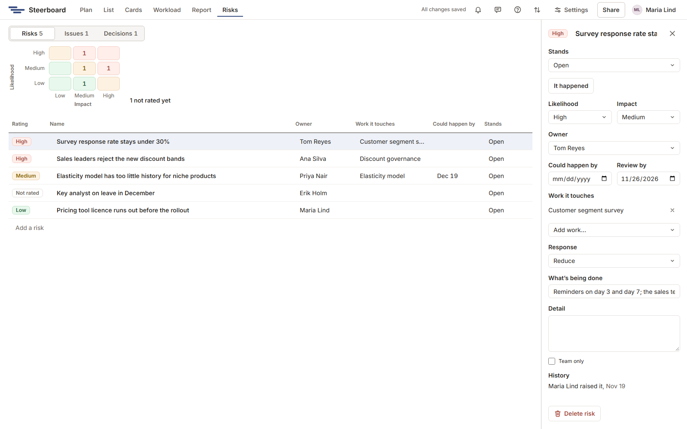

# Risks, issues and decisions

The **Risks** view keeps a project's log: what could go wrong, what is going
wrong, and what someone has to decide. Each entry has one owner and points at
the work it touches. Open it with the tab after **Report**, or
<kbd>Alt</kbd>+<kbd>6</kbd>.

- A *risk* is something that could happen. It's rated by how likely it is
  and how much it would hurt.
- An *issue* is something happening now, with a date to fix it by.
- A *decision* is something you need decided, by whom and by when. Once
  it's decided, it stays in the log as the record of what was decided and why.

## Add one

Pick **Risks**, **Issues** or **Decisions** at the top, then type a name
under the last line, where it says **Add a risk** (or **Add an issue**,
**Add a decision**), and press <kbd>Enter</kbd>. It opens in its details
beside the table, where you fill in the rest.

You can also start from the work: an activity's or milestone's details have
**Risks and issues**, listing the open ones that touch it, and **Add a risk**,
which makes one already linked to it.

## Rate a risk

Set **Likelihood** and **Impact**, each low, medium or high. Together they
give the rating:

| | Impact low | Impact medium | Impact high |
|---|---|---|---|
| Likelihood high | Medium | High | High |
| Likelihood medium | Low | Medium | High |
| Likelihood low | Low | Low | Medium |

A risk that isn't rated yet counts as medium. The grid above the risks shows
how many open risks sit in each square; click a square to see only those, and
click it again to see them all.

An issue has a **Severity** instead: low, medium or high.

## What an entry holds

- **Owner**: one person on the project's team. For a decision, **Who decides**
  says whose call it is: a person, or a forum such as the steering committee.
- **Could happen by** and **Review by** for a risk, **Fix by** for an issue,
  **Needed by** for a decision. A date that's gone by on something still open
  shows in red.
- **Work it touches**: the activities and milestones it threatens, holds up,
  or that wait on it. Deleting the work takes it off the entry; the entry stays.
- **Response** for a risk (reduce, avoid, transfer or accept), and
  **What’s being done** for a risk or an issue.
- **Detail**: the cause and effect, the context, the options.
- **How it was resolved** once an issue is resolved, and **Outcome and why**
  once a decision is made.
- **History**: who raised it and when, and every change since.

**Stands** says where it is: a risk is open, dealt with or didn't happen; an
issue is open or resolved; a decision is needed or decided.

## When a risk happens

**It happened** on an open risk closes it as happened and opens an issue with
the same owner, work and detail, its severity the risk's impact. On an open
issue, **Needs a decision** opens a decision about it. Each points back at the
one it came from, and one undo takes either back.

## On the plan

Under **Show** on the plan, tick **Risks and issues** to put a red dot on the
top left corner of any activity or milestone with an open high risk or an open
issue on it. Point at the dot to read what's open. It's off until you turn it
on, this browser remembers it, and the plan slide never shows it.

## Told to its owner

Whoever is made the owner of a risk, an issue or a decision finds it under the
bell, **For you**, as with work given to them. The bell also says when one of
theirs is due: a risk on its review date, an issue past the day it was to be
fixed by, a decision past the day it was needed by. Where the project emails
**When work is given to someone**, they get the same email as for work, a few
minutes later. Nobody is told about what they did themselves.

## In Excel

The Excel workbook from **Export…** has a second sheet, Risks, with every
entry in the plan's log: its kind, name, rating, owner, the work it touches,
its date, where it stands, what's being done and its detail. Entries kept
inside the team stay out of it. Bringing the workbook back in reads the plan's
sheet only, so the Risks sheet changes nothing.

## Team only

Tick **Team only** on an entry to keep it inside the team. It leaves the plan
and is kept apart, the way rates and budgets are: owners, editors and
contributors see it, marked Team only, and viewers never do. It never goes in
a report or on the slides. Untick it to put it back in the plan for everyone.

## Who can do what

Owners and editors do everything here. A contributor can raise a risk or an
issue of their own, and keep theirs up to date: where it stands, what's being
done, the detail and the outcome. Viewers read the log, apart from what's kept
inside the team.

## From the report's lists

Before the log, the report had its own **Decisions needed** and **Risks**
lists. Each line in them became an entry: a decision with who decides, its
date and whether it was decided; a risk with its owner (or the name you typed,
in its detail) and what's being done, not rated yet.
