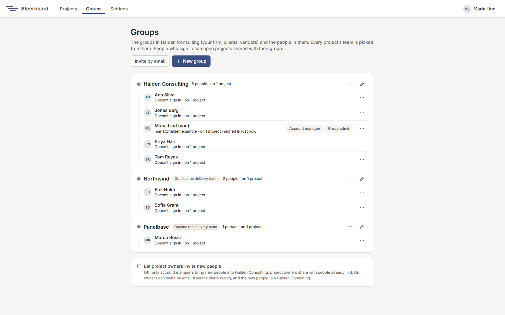

# Groups and people

Your account holds groups, and groups hold people. A group is a firm or team
on your engagements: your consultancy, a client, a vendor. Every project's
team is picked from here, so a person is the same person on every project.

Choose **Groups** in the header.

## How it fits together

- An **account** is what your company has with Steerboard. Its account
  managers run it.
- An account has **groups**, and groups have **people**.
- Some people **sign in**: they have an account login and see the projects
  shared with them. Others don't sign in at all: they're on the plan as owners
  of work (a client's finance director, say) without needing a login.
- Someone who signs in is in one group.

## Groups

| To | Do this |
|---|---|
| Make a group | Choose **New group**. Account managers can do this. |
| Rename it, recolour it, or mark it outside the delivery team | Choose its pencil. Changes apply on every project. |
| Add someone to it | Choose its +. |
| Delete it | From its pencil, when nobody is in it, it owns no projects and it's on no project's team. |

A group *outside the delivery team* (a client or vendor) shows as
**Waiting on** in the report when its people's work holds things up.

## People

Each person's row says whether they sign in and how many projects they're on.
Their menu (the three dots) holds the rest. For someone who doesn't sign in:
**Rename**, **Give sign-in…** and **Remove from the account…**. For someone
who does, account managers can **Make an account manager**,
**Set a temporary password…** or **Turn access off**.

- To give someone a sign-in, choose **Give sign-in…** in their menu and enter
  their email. When they accept the invitation, the person already on your
  plans becomes them, with all their work.
- To bring in someone new, choose **Invite by email** at the top of the page.
- People who sign in change their own name in **Settings**, and only account
  managers move them between groups.

## Letting owners invite

**Let project owners invite new people** is off by default: only account
managers bring new people into the account, and owners share with people
already in it. Switched on, owners can invite by email from the share dialog,
and the new people join your account.
