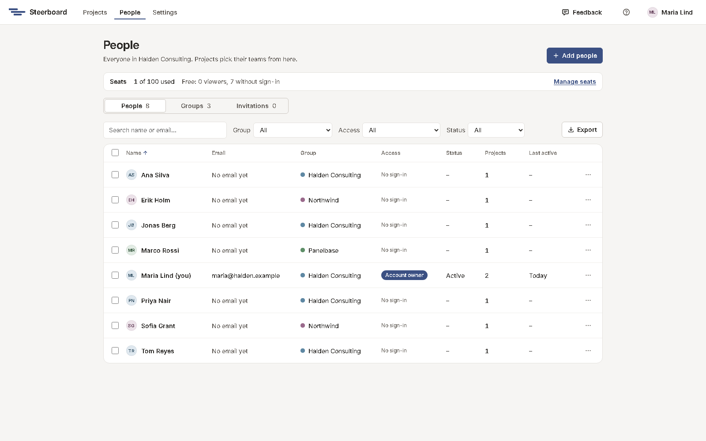
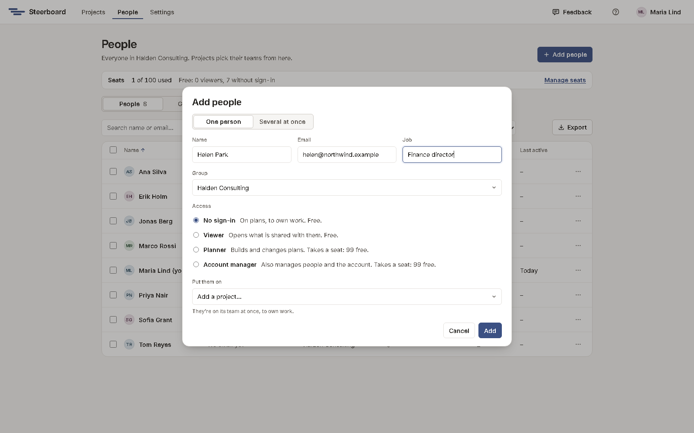
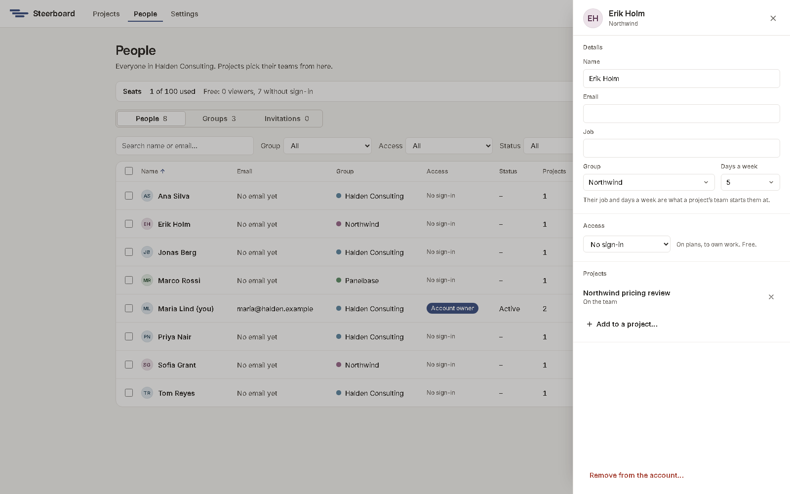

# People and groups

Everyone on your engagements is in your account once: your own consultants, a
client's finance director, a vendor's engineer. Every project picks its team
from this one list, so a person is the same person on every project.

Choose **People** in the header.

## Three things kept apart

- **Job** is what someone does: Data scientist, Finance director. A project's
  team starts them as that.
- **Access** is what they may do in Steerboard, for the whole account. It's
  one level per person.
- A project's **team** is who does the work on it. That's set in each
  project.

## Access

| Level | For | They can |
|---|---|---|
| **No sign-in** | People who only need to be named: a client's finance director, a vendor's engineer. | Be on plans and own work. They never sign in. |
| **Viewer** | Sponsors, steering committees, a client who follows along. | Open the projects shared with them, present the report and download slides. They never change a plan. |
| **Planner** | Project managers, consultants. | Start projects, build and change plans, share them and issue reports. |
| **Account manager** | Whoever runs Steerboard for your firm. | Everything a planner can, and manage people, groups, the account's settings and every project. |
| **Account owner** | One of the account managers. | The account is theirs. See [below](#the-account-owner). |

A person's level is the most they can do on any project. A viewer looks, even
on a project that's shared with their whole group for editing.

Planners see the list and can add someone who doesn't sign in. Viewers don't
have the People page: they see the people on the projects they can open. The
rest of this page is for account managers.

## Seats

Only the people who change plans take a seat: planners and account managers,
and an invitation to become one until it's accepted or cancelled. Viewers and
people who don't sign in are free, so a plan can hold everyone it concerns.

The line at the top of the People page says how many seats are used, how many
people are free, and has **Manage seats**. To see who holds a seat, pick
**Takes a seat** under **Access**.

- Making a planner a viewer, or turning their access off, frees their seat at
  once.
- With no seat free, nobody can be made a planner or an account manager until
  one is. Nobody loses a level they already have.

## Find people

The table shows each person's name and job, email, group, access, status, how
many projects they're on and when they were last here.

- Type in the search box to find by name, email or job.
- Narrow the list with **Group**, **Access** and **Status**.
- Choose a column's heading to sort by it; choose it again to turn the order
  round.
- **Export** saves the list, as it's filtered and sorted, as a spreadsheet
  file (CSV).

**Status** says where someone's sign-in stands: active, invited (and how long
ago), or **Access off**.

## Add people

Choose **Add people**.

For **One person**, fill in their name, **Email**, **Job** and **Group**, and
choose their **Access**. Each level says what it costs: free, or a seat and
how many are left. Under **Put them on** you can pick projects: they're on
those teams at once. Then choose **Add**, or **Add and invite** for someone
who signs in. They're sent an invitation by email; if email isn't set up, you
get a link to send them.

For **Several at once**, paste one person a line as name, email, job. Or
choose **Choose a file…** for a spreadsheet saved as CSV. Pick one group and
one access level for all of them, then **Check the list**. Each line shows
whether it can be added, and if not, why: no email address, already in your
account, or the same address twice. The button then adds the lines that can
be.

An email address is who someone is. No two people in an account share one,
and an address that signs in to another Steerboard account can't be added.

## One person

Choose a person to open their panel.

| Part | What's there |
|---|---|
| **Details** | Name, email, job, group and **Days a week**. Their job and days a week are what a project's team starts them at. People who sign in change their own name and email in **Settings**. |
| **Access** | Their level. Under it, their invitation (**Send again**, **Copy link**, **Cancel invitation**), or when they were last here and **Set a temporary password…**. |
| **Projects** | Every project they're on, with what they may do there. Change it in place, take them off with the cross, or choose **Add to a project…**. |

To let someone who doesn't sign in start signing in, change their access from
**No sign-in** to **Viewer**, **Planner** or **Account manager**. They're invited at the
address they have, and when they accept, the person already on your plans
becomes them, with all their work.

A person's menu in the table (the three dots) has the same actions:
**Open**, **Make a viewer**, **Make a planner** or
**Make an account manager**, **Move to** another group, **Send the invitation again**, **Set a temporary password…**,
**Turn access off** and **Remove from the account…**.

## Several people at once

Tick people in the table. A bar appears with what can be done to all of them:
**Change access**, **Move to group**, **Add to a project…**,
**Turn access off** and **Remove…**. Steerboard says how many it changed and
how many it left as they were.

## When someone leaves

There are two ways, and they differ.

- **Turn access off** keeps the person, their work and their place on every
  team. They can't sign in until you choose **Turn access back on**.
- **Remove from the account…** takes them out. Steerboard asks first who gets
  their unfinished work (someone else, or nobody for now) and who takes any
  project only they own. Finished work keeps their name. Their sign-in is gone
  for good, and the same address can be invited again later.

## Groups

Choose **Groups** on the People page. A group is a firm on your projects:
yours, a client, a vendor. Everyone is in one group, and a project can be
shared with all of it.

| To | Do this |
|---|---|
| Make a group | Choose **New group**. |
| Say what it is | Pick its kind in the table: **Our firm**, **Client**, **Vendor** or **Other**. |
| Rename or recolour it | Choose its three dots, then **Rename or recolour…**. The change applies on every project. |
| See who's in it | Choose the group, or **Show its people** in its menu. |
| Delete it | Choose **Delete…** in its menu. A group goes once nobody is in it and it owns no project. |

Late work owned by a client's or vendor's people shows in the report as
**Waiting on** that group.

A group can have admins, who look after its people and can manage the projects
it owns. Tick **Admin of** the group in a person's panel.

## Invitations

Choose **Invitations** on the People page to see every invitation that hasn't
been taken up yet, whether to the account or to one project. From there you
can **Send again**, **Copy link** or **Cancel** each. An invitation to plan
holds a seat until it's accepted or cancelled; an invitation to look holds
none.

## The account owner

Each account has one owner: the person who started it. The owner is an account
manager who can't be turned off, removed or made a planner.

The owner hands the account over under **Settings**, in **Account owner**:
pick another account manager and choose **Hand over…**. After that the former
owner is an account manager like any other.

## Who can invite

Under **Settings**, **Who can add people** says who may bring in people who
sign in:

| Choice | Means |
|---|---|
| **Account managers only** | Planners share projects with people already in the account. |
| **Planners too, as viewers** | Planners can also add viewers. Viewers are free, so it can't change the bill. Every account starts here. |
| **Planners too, at any level** | Planners can also add other planners, who each take a seat while one is free. |

Only account managers make someone an account manager. Every planner can
always add someone who doesn't sign in.
