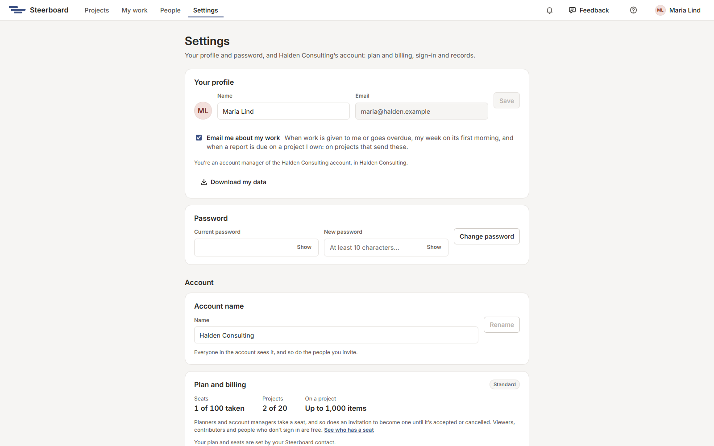

# Settings

Choose **Settings** in the header. It holds your own settings and, for
account managers, the account's.

## Your profile

Your name, as everyone sees it, and your email. **Download my data** gives you
everything Steerboard holds about you, as a file.

**Email me about my work** is ticked to start with: projects that send email
about their work (see [Project settings](../project-settings.md#emails-about-work))
send you yours. Untick it to get none.

## Password

Enter your current password and a new one of at least 10 characters. You stay
signed in where you are; other devices are signed out.

## Account (account managers)

| Section | What it does |
|---|---|
| **Account name** | Everyone in the account sees it, and so do the people you invite. |
| **Plan and billing** | The account's plan and what it allows: how many seats it has (planners and account managers each take one, and so does an invitation to become one; viewers and contributors are free), how many projects the account keeps (archived ones count), and how many items a project's plan can hold. |
| **Who can add people** | Who may bring in people who sign in: account managers only, planners too as viewers and contributors, or planners at any level. See [People and groups](people.md#who-can-invite). |
| **Links without signing in** | Whether a project's owner can turn on a view-only link to its status report: see [Sharing a project](sharing.md#a-link-that-opens-without-signing-in). Untick **Projects can have a view-only link** and no project can turn one on, and links that were on stop opening until it's ticked again. |
| **Account owner** | Whose the account is, and **Hand over…** for handing it to another account manager. See [People and groups](people.md#the-account-owner). |
| Single sign-on | Your company's email domains, a setup link for your IT to connect your identity provider, and whether everyone must use it. Account managers can always still use their password. |
| Audit log | Who did what in the account, and when: sign-ins, invitations, roles, sharing, projects and billing. |
| Your account's data | Everything in the account, as one file. |

The account's people and groups are on the [People](people.md) page.

## What a plan allows

Each plan sets how many seats the account has, how many people it can hold in
all, how many projects it keeps, and how many items (activities, milestones
and work packages) one project's plan can hold. The Standard plan allows 100
seats, 1,000 people, 20 projects and 1,000 items on a project. **Plan and billing** shows where the account stands.

When something would go past a limit, Steerboard says so and doesn't do it:
the invitation isn't sent, the project isn't created, or the change to the
plan isn't saved. A project already over its limit can still be changed and
made smaller, just not bigger.
