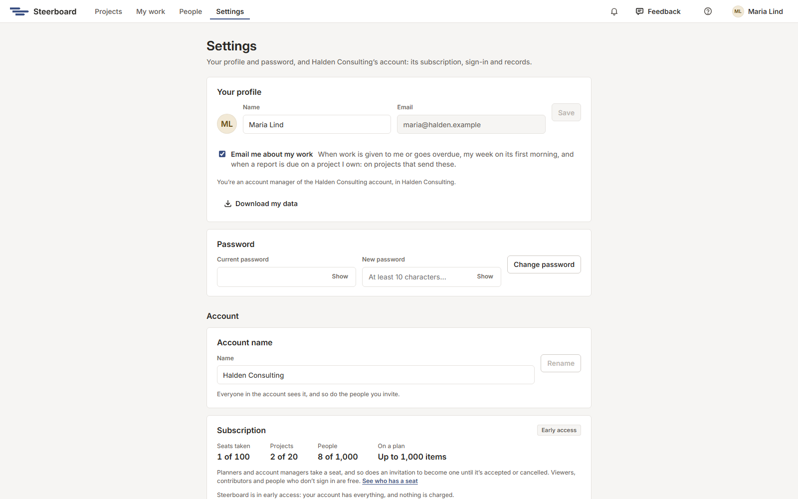

# Settings

Choose **Settings** in the header. It holds your own settings and, for
account managers, the account's.

## Your profile

Your name, as everyone sees it, and your email. **Download my data** gives you
everything Steerboard holds about you, as a file.

**Email me about my work** is ticked to start with: projects that send email
about their work (see [Project settings](../project-settings.md#emails-about-work))
send you yours. Untick it to get none.

## Password

Enter your current password and a new one of at least 10 characters. You stay
signed in where you are; other devices are signed out.

## Templates

For planners: the plans your account keeps to start projects from, beside
Steerboard's four. **Open** one to change it like any plan, or **Delete** it.
To make one, see
[Templates of your own](../getting-started/first-project.md#templates-of-your-own).

## Account (account managers)

| Section | What it does |
|---|---|
| **Account name** | Everyone in the account sees it, and so do the people you invite. |
| **Subscription** | The account's tier and what it holds: its seats (planners and account managers each take one, and so does an invitation to become one), viewers and contributors where the tier counts them, and its projects (archived ones count). See [The subscription](#the-subscription). |
| **Who can add people** | Who may bring in people who sign in: account managers only, planners too as viewers and contributors, or planners at any level. See [People and groups](people.md#who-can-invite). |
| **Links without signing in** | Whether a project's owner can turn on a view-only link to its status report: see [Sharing a project](sharing.md#a-link-that-opens-without-signing-in). Untick **Projects can have a view-only link** and no project can turn one on, and links that were on stop opening until it's ticked again. |
| **Account owner** | Whose the account is, and **Hand over…** for handing it to another account manager. See [People and groups](people.md#the-account-owner). |
| Single sign-on | Your company's email domains, a setup link for your IT to connect your identity provider, and whether everyone must use it. Account managers can always still use their password. |
| Audit log | Who did what in the account, and when: sign-ins, invitations, roles, sharing, projects and billing. If someone at Steerboard opens the account as its manager to help with it, the log says when they came and went, and lists what they changed as done by Steerboard. |
| Your account's data | Everything in the account, as one file. |

The account's people and groups are on the [People](people.md) page.

## The subscription

An account's subscription is on a tier. What each tier holds and what a seat
costs is on the [home page](https://steer-board.com/#pricing), and in Settings
under **See the tiers**.

Every tier has the plan, the list and the cards, agreed dates and delays, the
status report and presentation mode. A tier says how many seats the account
has. The tier that costs nothing also counts viewers and contributors and keeps
them to the account's email domain, and it counts projects. A tier also says
which of these the account has: issuing reports (each one kept, with a link to
share it and a PDF), your own logo and a client's template on the slides,
emails about work and reports, the Workload view, copying a project, what
changed since the last report, project owners inviting people, every project
on one timeline and as a table, single sign-on, the audit log, and the
account's data as a file.

On a tier without your own slides, each PowerPoint slide says "Made with
Steerboard" in its footer.

On the tier that costs nothing, everyone who signs in has an address on the
same email domain as the account's owner, and there's room for three of them
besides the planner. People who don't sign in are names on the plan and aren't
counted.

Steerboard is in early access for now. Every account has all of it and nothing
is charged, within 100 seats, 1,000 people, 20 projects and 1,000 items on a
project. **Subscription** says so, and shows where the account stands under
**Seats taken**, **Projects** and **People**.

When something would go past a limit, Steerboard says so and doesn't do it:
the invitation isn't sent, the project isn't created, or the change to the
plan isn't saved. A project already over its limit can still be changed and
made smaller, but not bigger.

### Choosing a tier

When tiers apply, a new account has a paid tier for its first days and
nothing is charged. **Subscription** shows **Trial** beside the tier, and says
the day those days end. After that the account is on the tier that costs
nothing until an account manager chooses one.

**Subscription** lists what the account's tier holds. **See the tiers** puts the tiers side by
side, with what each holds and what a seat costs, billed **Yearly** or
**Monthly**. Choose one, say how many seats you need, and pay on Stripe's
checkout page. You come back to Settings, and the account is on its new tier
within a minute.

Only planners and account managers need a seat. Viewers, contributors and
people who don't sign in are free on every tier.

After that:

- **Change tier** moves the account to another tier, or to the other way of
  paying. Stripe works out the difference for the time left.
- **Paid seats** and **Change seats** add seats or give some back, never
  fewer than are taken.
- **Invoices and payment** opens Stripe's page for your invoices, your card,
  and your company's address and tax number.
- **Cancel the subscription** is among the tiers, under the one that costs
  nothing. The subscription runs to the end of what's paid for. Until then
  **Keep the subscription** takes the cancellation back.

When a subscription ends, or an account's first days are over, the account is
on the tier that costs nothing and nothing is deleted. What that tier doesn't
include is locked: the reports you issued and a project's link are kept, and
open again on a tier that has them. Projects over its number stay, and no more
can be added until there's room.

People the tier has no room for are paused. The seats go to the account's
owner first, then to its other account managers, then to planners, in the
order they joined. The places for others go to the people on the account's
email domain, in the order they joined. Anyone else signs in to a page that
says their access is paused and who to ask. **Subscription** names them. Turn
off the access of someone who no longer needs it, or choose a tier, and they're
back as they were.

Something the account's tier doesn't include shows where it would be, with a
lock, so you know it's there.
