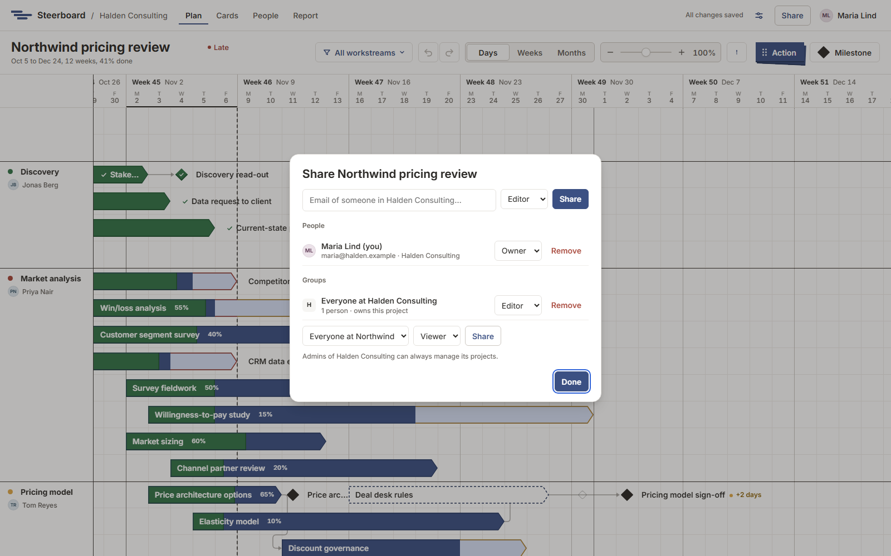

# Sharing a project

Choose **Share** in the bar at the top of a project. Only the project's owners
can change who has access; everyone else sees **Who has access**.

## Roles

| Role | Can |
|---|---|
| Owner | Everything, including sharing and deleting the project. |
| Editor | Change the plan, the team and the report. |
| Viewer | See every screen, present the report and download slides, without changing anything. |

## Share with people

Type the email address of someone in your account, pick their role and choose
**Share**. They'll find the project on their **Projects** page.

You can only share with people already in your account, unless an account
manager has switched on **Let project owners invite new people** on the
[Groups](groups.md) page. Then you can invite someone new by email from here,
and they join your account when they accept.

## Share with a group

Under **Groups**, pick one of your account's groups and a role, and choose
**Share**. Everyone in that group gets that role, including people who join
the group later. The group that owns the project is listed first.

The admins of the group that owns a project, and the account's managers, can
always manage it.

## Working together

Changes save as you make them. Other people's changes appear as they happen,
and the avatars in the bar show who else has the project open. Undo only
takes back your own changes.

## Invitations

An invitation is a link. When email is set up it's emailed; the link is also
shown, so you can send it yourself if it doesn't arrive. It works once.
