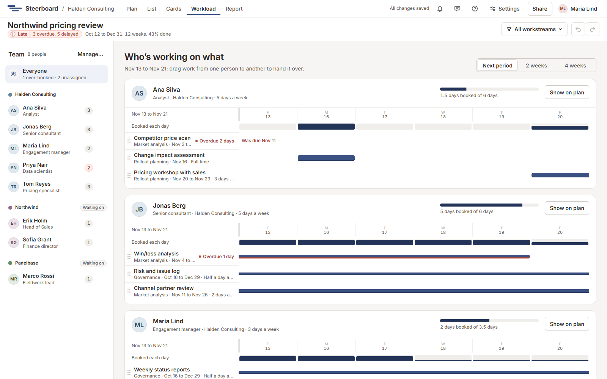

# Workload

Each project has a team: the people who can own work, sorted into groups such
as your firm, the client and a vendor. **Workload** shows the team and what
each person is working on.

## The team

The team list on the left sorts people under their groups. Each group has a
colour that tints its people's initials everywhere in the project. A group
outside the delivery team (the client, a vendor) carries a small
**Waiting on** tag.

This screen is for following the work. To change who is on the team, their
job on the project or their days a week, choose **Manage…** above the list. It
opens **Project settings** at **People**: see
[Sharing a project](sharing/sharing.md).

The days shown are the project's working days, as on the plan, so weekends
are left out.

## Who's working on what

On the right, one card per person for the next period (or **2 weeks** or
**4 weeks**):

- A meter of how many days they're booked against the days they have. It
  turns red when they're over-booked.
- A strip of each day's load, red where a day holds more than they have.
- Each piece of work as a bar across the days. A bar's height says how much of
  their week it takes. Drafts are dashed, as on the plan.

Overdue work stays on a person's card even if it should have ended before the
period. Work nobody owns is collected under **Unassigned**.

## Hand work over

Drag a piece of work onto someone's card or name. Or select several items on
the plan and give them to someone from the details panel.

## See one person's work on the plan

Click a person, then **Show on plan**. Everyone else's work fades on the plan
until you clear the chip in the toolbar. The plan's **Filter** does the same
under **Whose work**.

## Waiting on others

Agreed work owned by people in a group outside the delivery team that is
overdue, or due by the end of the next period, appears in the
[report](report/index.md) as **Waiting on** that group.
